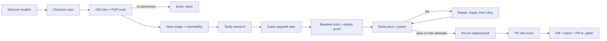

# PatchPilot

**An agentic DevSecOps tool for software supply chain security: it finds CVEs, upgrades dependencies, rewrites code until the tests pass, and proves the exploit is closed.**

Built on NVIDIA Nemotron (Nano / Super / Ultra) served by **Nebius Token Factory** (the default provider). External data sources: OSV.dev, PyPI, FIRST EPSS, CISA KEV, deps.dev, Tavily and the GitHub API. Any other OpenAI-compatible endpoint (NVIDIA NIM, or OpenRouter as a fallback) also works.

- **Hackathon:** NVIDIA Global AI Hackathon · **Track: Coding and Agentic Engineering** · LLMs: NVIDIA Nemotron on Nebius Token Factory · Research: Tavily
- **Live demo:** TODO <!-- TODO(owner): public URL of the deployed app; leave as TODO until it exists -->
- **Video:** TODO <!-- TODO(owner): link to the demo video -->

---

## Testing instructions for judges

**Hosted demo, no credentials needed.** <!-- TODO(owner): hosted demo URL (same as "Live demo" above). -->
1. Open `/projects`. Add a project (paste a GitHub URL, or upload or paste a `requirements.txt` such as `jinja2==2.10` / `requests==2.19.0`) and it is scanned against OSV.dev straight away, with EPSS, CISA KEV and fixed-in versions. Scanning needs no API key. **Add sample projects** adds the bundled demo cases.
1. Open `/console`. If the deployment has recorded runs, one replays automatically (the "LIVE REPLAY" badge); `/console?demo=1` is a guided walkthrough of a recorded run with captions. Recorded runs shipped with the repo are labelled **Sample**.
2. To pick a specific recording, use **Replay a recorded run** under the launch box, or open `/runs` and click **Replay** on any card. Failed runs show their failure reason on the card.
3. To start a live fix run, open a project (e.g. the `authsvc` sample) and press **Fix with agent**, which opens `/console?project=<id>`; then click **Launch agent**. This needs `NEBIUS_API_KEY` on the server; without it the button is disabled and the page says so and points to replay.
4. Tabs to look at after a run: **Advisories**, **Evidence (Tavily)**, **Certificate**, **Proof & risk**, **Drift radar**, **Diff**, **PR report**.

Recorded runs: new runs are written to `runs/*.jsonl` (git-ignored). The repo also ships `demo-runs/`, six recorded end-to-end runs on Nebius Token Factory plus their `batch-summary.json`, so a fresh clone or deployment can replay them immediately; the server reads both folders (a live run with the same id takes precedence).

**Judged deployment settings.** Leave `PATCHPILOT_TOKEN` **unset** on the judged deployment: when it is set, `POST /api/runs` requires `Authorization: Bearer <token>`, which the browser console does not send, so judges could not launch runs. Keep `ALLOW_REMOTE_REPOS=0` (only the sample projects can be fixed; any public GitHub repo can still be scanned, because scanning only downloads and parses manifest files and never runs repository code).

**Local run.** `cp .env.example .env`, set `NEBIUS_API_KEY` (and `TAVILY_API_KEY` for research), then `pip install -r requirements.txt` and `uvicorn patchpilot.server:app --port 8000` (or `run.bat` on Windows); see [Quickstart](#quickstart). Tests: `pytest`.

## The problem

Dependency bots open a version-bump PR and stop there. When the fix needs a **major** version, the bump breaks the build, the PR goes red, and the known vulnerability stays in production until someone finds time to migrate the code. The bump is easy. The fix is the hard part.

## How it works



1. **Scan**: every pin in `requirements.txt` is checked against OSV.dev; the latest version comes from PyPI.
2. **Triage**: Nemotron Nano judges each advisory against how your code actually uses the package.
3. **Research**: Tavily finds migration guides and breaking-change notes for each upgrade.
4. **Plan**: Nemotron Super picks target versions (with a version guardrail).
5. **Exploit proof**: a pytest demonstrating the vulnerability (from a curated, verified library for known CVEs, otherwise written by Nemotron) is run before the upgrade, then again after.
6. **Upgrade and repair**: pins are bumped in a fresh venv and pytest runs. On failure, Super writes the first fix; later attempts escalate to Ultra, up to `MAX_FIX_ATTEMPTS`.
7. **Ship**: risk score, unified diff, Markdown report with cited evidence, and a GitHub PR (when `GITHUB_TOKEN` is set and the repo is a GitHub URL) or a `.patch` file.

## Features

- **Live agent graph**: each pipeline step streams to the console over SSE.
- **Exploit proof**: a curated or Nemotron-written test shows the vulnerability before the upgrade and checks it is closed after.
- **Threat clock**: each advisory gets its live EPSS exploit probability (FIRST.org), CISA Known Exploited status and how many days it has been public, so you fix what attackers actually use first.
- **API drift radar**: before any test runs, PatchPilot walks your code's AST, then probes the *installed* old and new library versions in the sandbox to predict exactly which lines break (removed symbols, dropped keyword arguments), and hands that list to the repair model. Behaviour changes are left to the tests.
- **Least-change upgrade**: the smallest release that clears every advisory is computed from OSV fix ranges and shown next to the latest version.
- **Content-safety gate**: every AI-written exploit proof, red-team variant and patch file is screened before it runs or is written: a deterministic AST scan (shell/subprocess calls, eval/exec, environment reads, network calls to non-local hosts, deletes and opens outside the repo, reverse-shell and miner strings, non-PyPI requirement sources) plus NVIDIA's `nemotron-3.5-content-safety` guard model in custom-policy mode (`MODEL_GUARD` selects it; it is filled in automatically only on OpenRouter, so on Nebius Token Factory set `MODEL_GUARD` to the content-safety model id your account lists; `GUARD=0` disables the gate). Blocked proofs are skipped and blocked patch files are rejected, with the reason fed to the next repair attempt. If the guard model errors (e.g. 429), only the static scan runs and the ledger claim drops to partial. Curated proofs get the static scan only.
- **Red-team variants**: after the fix, 5-8 variants of the attack (other algorithms, key types, encodings) run against the patched code; each is reported as closed by fix, already blocked, or still open.
- **Proof certificate (evidence ledger)**: every claim the PR makes, each checked independently, including a fresh OSV re-scan of the new pins, a trust score, and a SHA-256 over claims + diff.
- **OpenVEX export**: each run emits an [OpenVEX v0.2.0](https://github.com/openvex/spec) document (`runs/work/<run>/openvex.json`, also `GET /api/runs/{id}/vex`) with one statement per advisory on `pkg:pypi/<name>@<old version>`: `fixed` only when the OSV re-scan cleared it and tests are green, `not_affected` only when static analysis shows the package is never imported (never from LLM-inferred data), otherwise `affected`. Notes cite the proof certificate id and exploit verdict.
- **Ranked research**: Tavily returns 8 results; they are ranked by Tavily's relevance score (Nemotron Nano scores them instead when Tavily gives no score) and only the top 4 reach the repair model.
- **PR risk score**: 0 to 100 from code churn, files touched, major-version jumps, repair attempts, test result and exploit proof.
- **Release trust check**: before upgrading, each old and target release is looked up on the free deps.dev v3 API: publish date, whether the target carries a *verified* PyPI publish attestation (and whether the old one did), its source repo, the repo's OpenSSF Scorecard (overall plus Code-Review, Maintained, Signed-Releases, Dangerous-Workflow) and any transitive dependencies the target adds. This feeds a "Supply-chain trust" risk factor (0 when deps.dev has no data) and a ledger claim. In our cases the latest releases (PyJWT 2.15.1, urllib3 2.8.0, Jinja2 3.1.6) all had verified attestations, while the old pins and the least-change targets from 2022-2024 (PyJWT 2.4.0, urllib3 1.26.19, Jinja2 3.1.3) had none; Scorecard is per repository, not per release (pyjwt 6.9, urllib3 8.6, jinja 5.9), and no upgrade added a new transitive dependency. slsaProvenances was empty for all of them.
- **Reachability map**: where each vulnerable package is used in your code.
- **Symbol-level reachability**: each advisory is labelled reachable (with file:line), imported-but-unused, not reachable, or unknown by matching its vulnerable symbols against an AST scan of your code (including re-exports and Jinja `|filter` uses in templates). Symbols come from OSV's PyPA `ecosystem_specific.imports` field when present, but in practice the OSV API returned that field for 0 of the advisories in our six benchmark cases, so most symbols are Nemotron Nano-inferred from the advisory text and labelled `llm-inferred`; if the LLM is unavailable those advisories stay `unknown`. The result feeds triage, an advisory-urgency rating next to the risk score, and a ledger claim (verified only when every symbol came from OSV).
- **Model debate**: each repair attempt's diagnosis (Super, then Ultra) side by side.
- **Org-wide heat map**: scans a GitHub user or org's public Python repos for vulnerable pins.
- **Replay**: recorded runs in `runs/` replay without spending API credits.
- **Voice briefing**: a spoken run summary using the browser's speech synthesis.
- **Cited evidence**: fixes quote the Tavily sources they relied on.

## How Tavily is used

Tavily is called at runtime on every run that has advisories, when `TAVILY_API_KEY` is set (`patchpilot/sources.py: tavily_search`, called from `patchpilot/agent.py: _analyse`):

1. **Research query** per vulnerable package: `"<package> upgrade <current> to <latest> breaking changes migration guide"`, sent to `POST https://api.tavily.com/search` with `search_depth: "advanced"`, `include_answer: true`, `max_results: 8`. Up to 3 packages are researched in parallel, alongside triage.
2. **Ranking**: results are sorted by Tavily's own relevance score (shown 0-10). If Tavily returns no scores, Nemotron Nano reranks them. The top 4 (plus Tavily's answer) are kept.
3. **Used by the models**: the kept results' URLs and text go to the repair model (Super / Ultra) as `migration_research`, and the top 2 to the exploit-proof writer when no curated proof exists. The repair model must quote the exact lines it relied on, with their URL.
4. **Citations**: the console's **Evidence (Tavily)** tab lists every source under "Research via Tavily" plus the quoted lines, and the PR report has a "Sources consulted (Tavily)" section and the quotes with their URLs. The ledger records how many quoted lines came from researched sources.

**Example from a recorded run** (`demo-runs/20261029-153834-job.jsonl`, authsvc). The PyJWT query returned `pyjwt.readthedocs.io/en/stable/changelog.html` (score 8.2), a Yocto patchwork upgrade thread (7.2), `security.snyk.io/package/pip/PyJWT/1.7.1` (6.9) and `github.com/jpadilla/pyjwt/releases` (6.0); the requests query returned `requests.readthedocs.io/en/latest/community/updates` (8.3) and three more. Super's first patch did not pass. Ultra's second patch went green, citing two lines from the PyJWT changelog: *"The `verify` argument to `decode` does nothing in PyJWT 2.0 and newer. The equivalent is setting `verify_signa[ture]`..."* and *"Reject empty HMAC keys"*. The ledger records "3 quoted line(s) from researched sources", and the PR report lists all eight URLs under "Sources consulted (Tavily)". Other runs cite `urllib3.readthedocs.io/en/stable/v2-migration-guide.html` (fetcher) and `jinja.palletsprojects.com/en/stable/changes` (mailer: *"The `jinja2.Markup` class is available as before, but it is now just an alias for `markupsafe.Markup`."*).

Without `TAVILY_API_KEY`, research is skipped and logged; the rest of the pipeline still runs.

## Model routing

| Tier | Job |
|---|---|
| Nemotron **Nano** | Advisory triage against code usage (cheap, high volume) |
| Nemotron **Super** | Upgrade plan, exploit-proof test when no curated one exists (Ultra as fallback), first repair attempt |
| Nemotron **Ultra** | Escalated repair attempts when Super's fix still fails tests |

### Nemotron model roles

| Model | What | Why | When escalated |
|---|---|---|---|
| **Nano** | Advisory triage, vulnerable-symbol inference for reachability, research rerank (when Tavily gives no scores) | High volume, short answers: cheapest and fastest | Never; failures fall back to `unknown` / Tavily order |
| **Super** | Upgrade plan, exploit-proof test (no curated one), first repair attempt | Good code quality at moderate cost | Exploit writing falls back to Ultra; repair moves to Ultra after a failed attempt |
| **Ultra** | Later repair attempts | Deepest reasoning, used only when needed | Reached when Super's fix fails tests or a fix call exceeds `FIX_TIMEOUT` |
| **Guard** (`MODEL_GUARD`, optional) | Content-safety screen of AI-written proofs, variants and patch files | Blocks unsafe code before it runs | On error (e.g. 429) only the static AST scan runs |

Models are auto-discovered from `/models` unless pinned with `MODEL_NANO` / `MODEL_SUPER` / `MODEL_ULTRA`. Tokens, latency and (if `PRICE_*` is set) cost are tracked per tier.

## Quickstart

**Windows**

```bat
run.bat
```

Creates `.venv`, installs dependencies, copies `.env.example` to `.env` on first run (opens it in Notepad for your keys), then serves http://localhost:8000.

**Manual (any OS, Python 3.10+)**

```bash
python -m venv .venv
source .venv/bin/activate          # Windows: .venv\Scripts\activate
pip install -r requirements.txt
cp .env.example .env               # add your keys
uvicorn patchpilot.server:app --port 8000
```

Then:

1. **Create a project**: open http://localhost:8000/projects and paste a GitHub URL (optional branch/tag), or upload or paste a manifest: `requirements.txt`, `pyproject.toml` (PEP 621 or Poetry), `poetry.lock`, `uv.lock` or `Pipfile.lock` (200 KB max). With `ALLOW_LOCAL_PATHS=1`, `POST /api/projects {"path": "/abs/dir"}` also accepts a directory on the server.
2. **Scan**: runs automatically when the project is added, and again with **Scan now**. No API key needed. Pinned packages are looked up on OSV.dev and enriched with EPSS, CISA KEV and the lowest fixed version; unpinned ones are listed but not checked. Scanning never installs or runs project code (GitHub manifests are fetched as raw files), so it works for remote repos even with `ALLOW_REMOTE_REPOS=0`; that flag only gates fix mode.
3. **Fix**: on a GitHub or sample project, press **Fix with agent** (needs `NEBIUS_API_KEY`; GitHub projects also need `ALLOW_REMOTE_REPOS=1`). Uploaded manifests can be scanned but not fixed, because the agent needs the code and tests.

Projects, scans, findings and an audit log of every change are stored in SQLite at `PATCHPILOT_DB` (default `runs/patchpilot.db`); each agent run's events stay in `runs/<id>.jsonl`.

CLI / batch mode: `python -m patchpilot.cli case:authsvc ...`. Container: see `Dockerfile`.

- Pages: `/` landing, `/projects` projects and scan results, `/console` run the agent, `/runs` history and replay, `/org` org scan, `/how` architecture.
- API: `/api/health` (GET/HEAD; includes configured model ids per tier, no secrets), `/api/stats`, `/api/projects` (GET, POST), `/api/projects/samples` (POST), `/api/projects/{id}` (GET, DELETE), `/api/projects/{id}/scan` (POST), `/api/projects/{id}/scans`, `/api/scans/{id}`, `/api/runs` (POST takes `{"project": id}` or `{"repo": url}`), `/api/runs/{id}/events`, `/api/org/{owner}`, `/api/bench`, `/api/cases`. Mutating project endpoints use the same `PATCHPILOT_TOKEN` bearer check and per-IP rate limit as runs.
- Sample projects come from `cases/` (pins from each `requirements.txt`):
  - `authsvc`: PyJWT 1.7.1 + requests 2.25.1
  - `fetcher`: urllib3 1.26.17
  - `mailer`: Jinja2 2.11.3 + MarkupSafe 2.0.1
  - `sanitizer`: bleach 3.2.1
  - `sqlfmt`: sqlparse 0.4.1
  - `webhooks`: Werkzeug 2.0.3

## Tests

Fast, offline unit tests for the agent itself (drift radar, OSV version math, JSON parsing, exploit library,
risk score and trust ledger). No network, no LLM calls:

```bash
pip install -r requirements.txt -r requirements-dev.txt
.venv/Scripts/python.exe -m pytest -q
```

`pytest.ini` limits collection to `tests/`; the bundled `cases/*/tests` suites need their own pinned venvs and
are run by PatchPilot's sandbox instead.

## Speed

Early recorded runs on free OpenRouter Nemotron endpoints showed that model calls took 97 to 98 % of wall time
(authsvc: 709 of 723 s, mostly hidden reasoning tokens). The current pipeline makes these changes (on Nebius Token Factory
the same authsvc case finished in 110.7 s with live Tavily research (64.7–136.4 s per case), see [Built on Nebius](#built-on-nebius)):

- Reasoning control per call (`reasoning="off"|"low"`). It uses OpenRouter's `reasoning` object or NIM/vLLM's
  `enable_thinking`. If the provider rejects the field, PatchPilot retries without it and stops sending it.
  JSON mode is used where accepted. Fix calls have a 90 s cap, and a call that hits it escalates to Ultra.
- Nano triage is capped at 1500 tokens with reasoning off. It is skipped when static reachability is conclusive.
  Research is ranked by Tavily's own relevance score, with no model call.
- Reachability and triage run alongside Tavily research (3 workers).
- The sandbox is prepared in the background right after checkout, using `uv` when it is on PATH.
  Measured locally for authsvc's pins: `uv` venv + install takes 0.2 to 0.3 s, against 5.8 to 5.9 s for
  `venv` + pip.
- `PATCHPILOT_DEMO=1`: at most 2 fix attempts, and curated exploit proofs and variants only.

End-to-end timings on Token Factory are in the recorded benchmark below (528.6 s for all six cases).

## Provider setup

The LLM client is OpenAI-compatible and reads `NEBIUS_API_KEY` and `NEBIUS_BASE_URL`. Nebius Token Factory is the default (`NEBIUS_BASE_URL` falls back to `https://api.tokenfactory.nebius.com/v1` when unset); the other providers are optional.

**1. Nebius Token Factory (default)**
```ini
NEBIUS_API_KEY=your-nebius-key
NEBIUS_BASE_URL=https://api.tokenfactory.nebius.com/v1
# optional: content-safety gate model (not auto-filled outside OpenRouter)
MODEL_GUARD=<content-safety model id listed by GET /v1/models>
```
Auto-discovery matches `nano`/`lightning`/`mini`, `super` and `ultra` in Nemotron model ids. To be safe, pin the ids (e.g. `MODEL_NANO=nvidia/Nemotron-3_5-Lightning`, `MODEL_SUPER=nvidia/nemotron-3-super-120b-a12b`, `MODEL_ULTRA=nvidia/Nemotron-3-Ultra-550b-a55b`; see `.env.example`). Check them against `GET /v1/models` first. Without `MODEL_GUARD` the content-safety gate still runs its static AST screen.

**2. NVIDIA NIM**
```ini
NEBIUS_API_KEY=nvapi-...
NEBIUS_BASE_URL=https://integrate.api.nvidia.com/v1
```

**3. OpenRouter (free tier, fallback)**
```ini
NEBIUS_API_KEY=sk-or-...
NEBIUS_BASE_URL=https://openrouter.ai/api/v1
MODEL_NANO=nvidia/nemotron-3.5-lightning:free
MODEL_SUPER=nvidia/nemotron-3.5-super-vl:free
MODEL_ULTRA=nvidia/nemotron-3-ultra-550b-a55b:free
```
On OpenRouter `MODEL_GUARD` defaults to `nvidia/nemotron-3.5-content-safety:free`.

Optional: `TAVILY_API_KEY` (research; skipped if unset), `GITHUB_TOKEN` (real PRs, higher org-scan rate limit), `PRICE_*`, `MAX_FIX_ATTEMPTS`, `PATCHPILOT_TOKEN` (requires `Authorization: Bearer <token>` on `POST /api/runs` and on project changes), `ALLOW_REMOTE_REPOS=1` to let fix mode run remote GitHub repos (off by default: fixing runs the repo's test code; scanning is always allowed), `ALLOW_LOCAL_PATHS=1` for projects that point at a server directory, and `PATCHPILOT_DB` for the SQLite file.

## Built on Nebius

- **Token Factory is the default LLM host.** `patchpilot/config.py` defaults `NEBIUS_BASE_URL` to `https://api.tokenfactory.nebius.com/v1`, and `patchpilot/llm.py` sends every model call there with the `NEBIUS_API_KEY` bearer token. Models are discovered from Token Factory's `/models` list, or pinned with `MODEL_NANO` / `MODEL_SUPER` / `MODEL_ULTRA`.
- **Nemotron roles** (router in `patchpilot/llm.py`):
  - **Nano** (`nano` / `lightning` / `mini` ids): fast, cheap triage and classification: advisory triage and symbol inference for reachability.
  - **Super**: planning and first-pass code changes: upgrade plan, exploit-proof test when no curated one exists, first repair attempt.
  - **Ultra**: deep reasoning on escalation: later repair attempts when Super's fix still fails tests, or when a fix call hits the `FIX_TIMEOUT` cap.
  - **Guard** (`MODEL_GUARD`, optional): NVIDIA Nemotron content-safety model screening AI-written code before it runs.
- Tokens, latency and (with `PRICE_*`) cost are recorded per tier for every run.

### Recorded benchmark on Token Factory (2026-10-29)

All six bundled cases were run end-to-end with `python -m patchpilot.cli` against `https://api.tokenfactory.nebius.com/v1`, models pinned to `nvidia/Nemotron-3_5-Lightning` (Nano), `nvidia/nemotron-3-super-120b-a12b` (Super) and `nvidia/Nemotron-3-Ultra-550b-a55b` (Ultra). Five rows come from round 3, which ran with `TAVILY_API_KEY` set, so every one of them made live Tavily calls (sources in the last column). The sanitizer row is the round-2 run, recorded without Tavily (see below). No guard model was used (Token Factory's `/models` listed no Nemotron content-safety model for this account), so only the static AST screen ran. Recordings are in `demo-runs/`.

| Case | Run id | Result | Fix attempts | Wall time | Exploit | Red-team blocked | Trust | Tavily sources |
|---|---|---|---|---|---|---|---|---|
| authsvc (PyJWT, requests) | `20261029-153834-job` | green | 2 (Super, then Ultra) | 110.7 s | proven closed | 7/8 | 85 | 8 (2 packages) |
| fetcher (urllib3) | `20261029-154025-job` | green | 1 | 136.4 s | proven closed | 7/7 | 91 | 4 |
| mailer (Jinja2) | `20261029-154242-job` | green | 1 | 85.9 s | proven closed | 8/8 | 91 | 4 |
| sanitizer (bleach) | `20261029-153214-job` | green | 1 (+ `tinycss2` added by the dependency step) | 65.4 s | proven closed | 8/8 | 86 | 0 (Tavily not configured in that round) |
| sqlfmt (sqlparse) | `20261029-154551-job` | green | 0 (upgrade alone passed) | 65.5 s | proven closed | 5/5 | 83 | 4 |
| webhooks (Werkzeug) | `20261029-154657-job` | green | 1 | 64.7 s | proven closed | 8/8 | 91 | 4 |

**6/6 cases green**, 528.6 s total wall time, 45,904 input / 39,321 output tokens across 23 model calls (Nano 10, Super 12, Ultra 1; Ultra was only needed in authsvc). Cost was not computed (`PRICE_*` unset). In 4 of the 5 Tavily runs, the ledger claim "Code changes cite migration sources" is verified (sqlfmt needed no repair, so nothing was quoted).

The round-3 sanitizer run (`20261029-154409-job`) was not green. Super wrote `bleach.css_sanitizer.CSSSanitizer` without importing the submodule, and Ultra then guessed the wrong import path. Its last two replies were also dropped as "not valid JSON". That was a PatchPilot bug: the reply quoted the Tavily-sourced bleach changelog line `pip install 'bleach[css]'` together with its Markdown code fence, and `parse_json` took that inner fence as the reply's own. The parser now tries the whole reply first and then one outer fence (`tests/test_llm.py::test_parse_json_fence_inside_string`). A sanitizer rerun with the fix could not be recorded in this session, so the table keeps the green round-2 sanitizer run.

The sanitizer case first failed in 3 of 3 runs (e.g. `20261029-151849-job`): bleach 6 needs `tinycss2` for `CSSSanitizer`, and Nemotron chose an import fallback that drops `style` attributes instead of adding the dependency, so `test_allowed_style_kept` failed and PatchPilot reported the run as not green. The repair loop now detects missing-module failures (`No module named X`, bleach's `NoCssSanitizerWarning`), tells the model that editing `requirements.txt` is preferred over removing features, and runs a deterministic dependency step before the next LLM call: a missing module that exists on PyPI is added pinned to its latest release, reinstalled and retested (reverted if the install fails), recorded as a `deps` event and evidence, and listed in the PR report (`patchpilot/deps.py`). In `20261029-153214-job`, Super's first patch moved to `css_sanitizer=CSSSanitizer(...)`, the test run hit `No module named 'tinycss2'`, the step added `tinycss2==1.5.1`, and all 5 tests passed. Round 2 (`20261029-151559-job` to `20261029-152206-job`, no Tavily) was also 6/6 green with these fixes: 389.6 s in total and 26 model calls.

A first round on Token Factory (`20261029-150603-job` to `20261029-151314-job`, same 5/6 result) exposed a bug: `reasoning="off"` was not sent to Token Factory, so Nano spent its whole 1500-token budget thinking and symbol inference / triage were skipped. Token Factory honours vLLM's `chat_template_kwargs.enable_thinking` (verified), so it now gets that switch; in the round above Nano's output fell from 3,000 to 203-1,721 tokens per run.

### Deploying on Nebius AI Cloud (how-to)

The `Dockerfile` supports both Nebius serverless modes. These steps describe how to deploy; they have not been carried out for this submission. <!-- TODO(owner): update if/when deployed. -->

- **Serverless Endpoint (web app + API).** Build the image and push it to a registry Nebius can pull from, then create an endpoint from it exposing port `8000`. Pass `NEBIUS_API_KEY` (and optionally `TAVILY_API_KEY`, `GITHUB_TOKEN`, `PATCHPILOT_TOKEN`, `MODEL_*`, `MODEL_GUARD`) as environment variables or secrets, and keep `ALLOW_REMOTE_REPOS=0` on a public endpoint. The image's `HEALTHCHECK` polls `/api/health`, which also answers `HEAD`.
- **Serverless Job (benchmark / batch).** Run the same image with the command overridden to the CLI: `python -m patchpilot.cli <repo-or-case> https://github.com/org/repo`. Runs are recorded under `runs/`; mount or copy that directory out to keep them.

## Screenshots

| View | Image |
|---|---|
| Landing | `docs/screenshots/landing.png` |
| Live console | `docs/screenshots/console.png` |
| Exploit proof + risk score | `docs/screenshots/risk.png` |
| Model debate | `docs/screenshots/debate.png` |
| Org heat map | `docs/screenshots/org.png` |

## Comparison

| | Dependabot | Renovate | Snyk | PatchPilot |
|---|---|---|---|---|
| Detects vulnerable dependencies | Yes | Yes | Yes | Yes (OSV.dev) |
| Opens upgrade PRs | Yes | Yes | Yes | Yes |
| Rewrites your code to fix breaking changes | No | No | not verified | Yes (LLM repair loop) |
| Runs your tests before proposing the PR | No (relies on your CI) | No (relies on your CI) | not verified | Yes, in a sandbox venv |
| Generates an exploit-proof test | No | No | not verified | Yes |
| Open source | Yes | Yes | No | Yes (MIT) |
| Ecosystems | Many | Many | Many | Python only |

## Limitations

- The NVIDIA content-safety guard has only had a small live check (n=2 passes over 6 samples via OpenRouter's free tier, [docs/guard-eval.md](docs/guard-eval.md)). It got 10 of 12 verdicts right: it flagged one benign curated proof and missed a base64 `exec` sample once. The static AST screen got all 12 right. Token Factory listed no Nemotron content-safety model for our account, so the recorded demo runs used the static screen only.
- Benchmark: 6/6 on Token Factory, but the recorded sanitizer run predates Tavily (its Tavily rerun is not recorded yet), and the bleach case needed the deterministic missing-dependency step; the model alone would not add `tinycss2` (see [Built on Nebius](#built-on-nebius)). The step only auto-adds a package with a curated import mapping or one the original repo already imported, whose first PyPI release is at least 90 days old, pinned to the newest non-yanked release that supports the sandbox Python; anything else becomes a hint for the model.
- Python only: needs a pinned `requirements.txt` (`pkg==x.y.z`) and a pytest suite.
- Tests run on the host in a venv, not a container; keep `ALLOW_REMOTE_REPOS=0` on public deployments.
- Free-tier models (e.g. OpenRouter `:free`) can be rate-limited, slow, or return malformed JSON, so runs may fail or need a retry.
- Green tests are only as strong as the repo's test suite.

## Feedback on Nebius & NVIDIA tools

<!-- TODO(owner): write this from first-hand experience. Prompts:
  - Token Factory: onboarding, finding the Nemotron model ids, /v1/models accuracy, rate limits, latency, pricing clarity.
  - Nemotron Nano / Super / Ultra: JSON reliability, reasoning control, where each tier surprised you.
  - Nemotron content-safety guard: custom-policy prompt format, false positives/negatives.
  - Nebius Serverless Endpoints / Jobs: if used, what worked and what was missing.
  - Differences between NVIDIA NIM and Token Factory (e.g. enable_thinking).
  - One concrete change you would ask each team for. -->
TODO

## Changes during the submission period

Every commit in this repository is dated 2026-10-29 (check with `git log --format=%ad`). <!-- TODO(owner): confirm the official submission-period dates and whether any work predates them. --> In order:

- **Initial agent** (00:29): security advisory to tested PR on NVIDIA Nemotron + Nebius Token Factory.
- **Core features**: multipage UI, verified exploit proofs, risk score, reachability, model debate, org scan, red-team variants, proof certificate, Nemotron rerank, threat clock, API drift radar, least-change upgrade, real-world benchmark cases.
- **Benchmark and self-tests**: benchmark round 1 on the OpenRouter free tier (3/3 completed cases secured; 3 cases blocked by API rate limit), agent self-test suite, provider and models recorded per run.
- **Nebius benchmark**: full 6-case run on Nebius Token Factory (6/6 green after the missing-dependency repair step), Token Factory reasoning-switch fix, recorded runs shipped in `demo-runs/`; round 3 re-recorded five cases with live Tavily research and fixed a JSON-parsing bug that research text exposed.
- **Supply-chain depth**: curated exploit proofs for urllib3, Jinja2, bleach and sqlparse CVEs; symbol-level reachability; deps.dev release trust check; OpenVEX export; Nebius model id pinning.
- **Speed and safety**: reasoning control, parallel triage/research, `uv` sandbox prep, demo mode; API keys kept out of the sandboxed repo's environment; NVIDIA content-safety gate + static AST screen.
- **UI**: guided demo mode, auto-replay console, trust / OpenVEX / guardrails panels, per-tier charts.
- **Hardening**: auth + rate limits, token-safe PR push, CI, CSP and security headers, no inline scripts, XSS-safe report links, org-scan limits, accessibility, SEO meta, gzip.
- **Submission drafts**: Devpost text, video script, judge Q&A, 30-second pitch.
- **Hardening round 4**: no inline styles (CSP without `style-src 'unsafe-inline'`), `HEAD` on `/api/health` and `/api/runs`, `/robots.txt`, org-scan `reason` field, reduced-motion CSS, this README's Nebius sections.

## Roadmap

- Auto-rollback guard: revert an upgrade if post-merge checks regress.
- Slack bot: briefings and approvals in chat.
- npm ecosystem support.

## Credits

Vulnerability data from [OSV.dev](https://osv.dev). Package metadata from [PyPI](https://pypi.org). Exploit likelihood from [FIRST EPSS](https://www.first.org/epss/). Known-exploited status from [CISA KEV](https://www.cisa.gov/known-exploited-vulnerabilities-catalog). Release trust data from [deps.dev](https://deps.dev). Web research by [Tavily](https://tavily.com). Pull requests and org scans via the [GitHub API](https://docs.github.com/rest).

## License

MIT, see [LICENSE](LICENSE).
