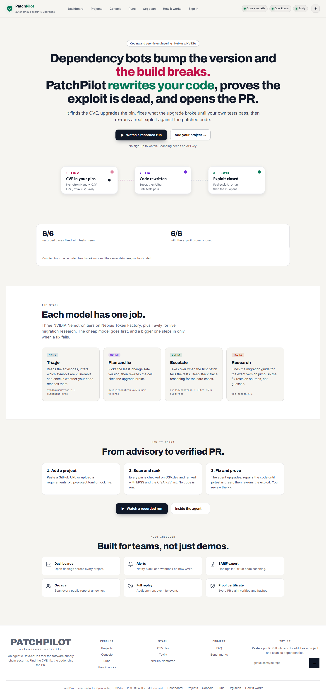
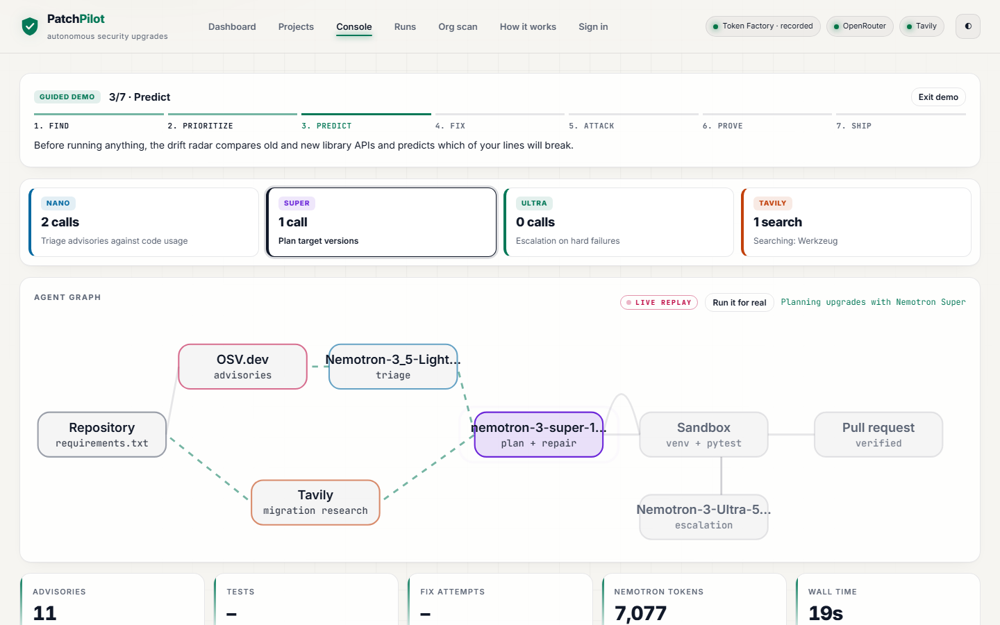
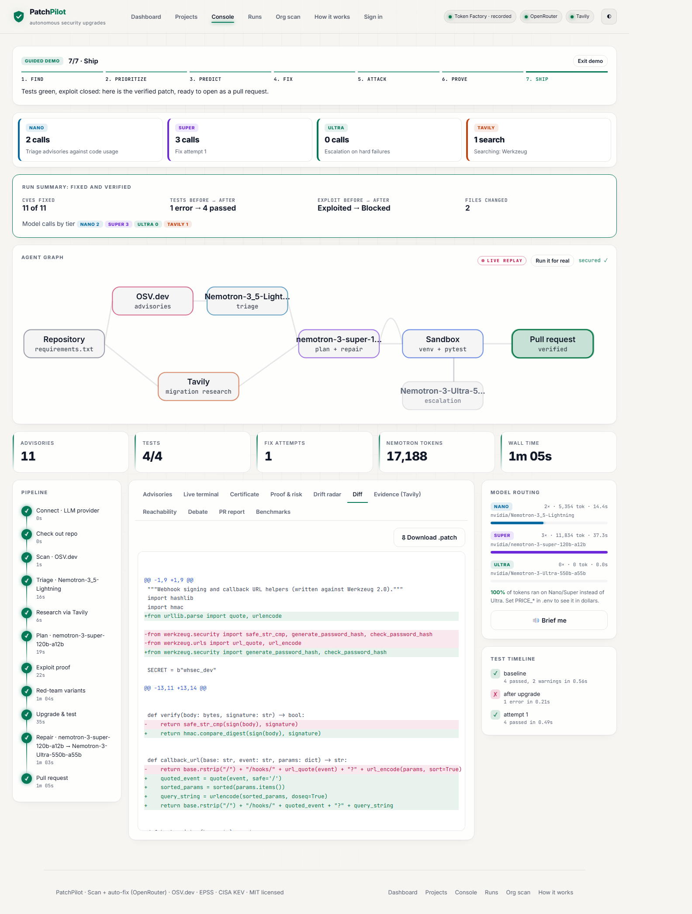
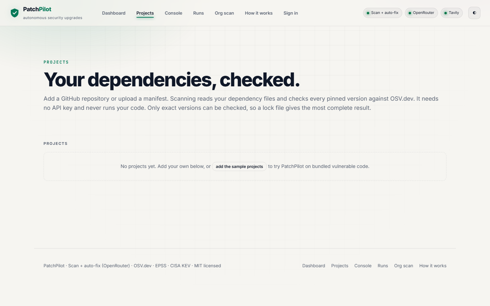
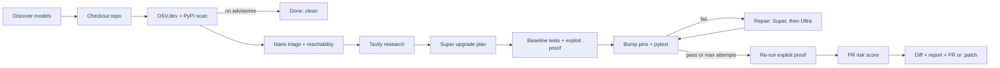

# PatchPilot

**Dependabot opens the PR. PatchPilot makes it mergeable, and proves it.**

Dependency bots bump the version and stop. When the bump breaks your code, the PR goes red and the CVE stays in production. PatchPilot takes over at that point: it rewrites the broken code, shows the exploit working before and blocked after, and checks that your functions still return exactly what they did before.

### What no other dependency tool does

| | Dependabot / Renovate | Snyk / commercial SCA | **PatchPilot** |
|---|:-:|:-:|:-:|
| Bumps the vulnerable version | ✓ | ✓ | ✓ |
| Rewrites your code when the bump breaks it | ✗ | partial | **✓ (Nemotron Super → Ultra)** |
| **Rescues an existing red Dependabot PR in place** | ✗ | ✗ | **✓ (paste the PR URL)** |
| **Behaviour lock: proves your functions return the same results after the fix, even with no tests** | ✗ | ✗ | **✓** |
| **Runs the exploit before and after to prove it is closed** | ✗ | ✗ | **✓ (+ red-team variants)** |
| **Finds and fixes vulnerable *transitive* dependencies your requirements.txt never names** | lockfile only | ✓ (reports) | **✓ (scans the installed tree, pins the least-change fix)** |
| Predicts which of your lines break *before* running tests | ✗ | ✗ | **✓ (API drift radar)** |
| Signed certificate of every claim the PR makes | ✗ | ✗ | **✓** |

**1. PR rescue.** Paste the URL of a red Dependabot or Renovate PR into the console (`https://github.com/you/repo/pull/42`). PatchPilot sets the baseline on the pins from the base branch, applies the bot's versions, repairs the code, and pushes the fix **onto the PR's own branch** with a comment. The PR turns green in place, with no new PR and no change to your workflow.

**2. Behaviour lock.** Tests only check what someone thought to assert, and many repos have almost none. Before upgrading, Nemotron writes calls into *your* public functions. A fixed harness (not the model) records the results twice on the vulnerable pins and drops anything non-deterministic. After the repair, every call must return exactly the same thing. Any difference goes back into the repair loop **even when pytest is green**. On the `authsvc` sample, PyJWT 1.7.1 → 2.10.1 changed 4 of 5 locked behaviours and the lock caught all 4. The time-dependent raw token was correctly dropped as unstable.

**3. Transitive fixes.** Most vulnerable code arrives as a dependency of a dependency. After the baseline install PatchPilot lists every package actually installed in the sandbox, checks the unpinned ones against OSV in one batch, and pins each vulnerable one to the smallest release that clears every advisory. If a pin clashes with a parent's version range it is dropped, and the direct upgrade still goes through. A project whose direct pins are clean is only called clean once its installed tree is too. With `requests==2.19.0`, PatchPilot finds `idna 2.7` and `urllib3 1.23` (14 advisories, neither in requirements.txt), pins them, and a re-scan after the fix finds 0 vulnerable transitive packages.

**4. Supply-chain intelligence beyond CVEs.** Every scanned project gets a Supply chain report built from PyPI metadata and OSV, with no AI involved:
- **Known-malicious packages:** OSV `MAL-` advisories.
- **Typosquats:** `reqeusts`, `python-requests`, `crypt0graphy` and the like. A lookalike name alone isn't flagged: the package must also be missing from PyPI, or be new with few releases. On 358 real dependencies from Flask, FastAPI, Pydantic, Black and httpx this flagged only two packages, `httpx2` and `httpcore2`, both recently published lookalikes.
- **Package health:** pins the maintainer yanked, packages abandoned for 2+ years or marked Inactive, and packages first published under 90 days ago.
- **License classes:** permissive, weak copyleft, strong copyleft (GPL/AGPL/SSPL) or undeclared.

**5. More ways in, and more ways out.**
- **SBOM import.** Projects can be a GitHub repo, a manifest, a lock file, or a **CycloneDX or SPDX SBOM** (`*.cdx.json`, `*.spdx.json`, `bom.json`). Non-Python components are counted and reported, never silently dropped.
- **One-click fixed `requirements.txt`.** Every vulnerable pin moves to its least-change safe version, and each changed line says why. No AI is needed.
- **Signed README badge.** A public SVG (`patchpilot | 3 vulnerabilities`) with an HMAC-signed URL, so nobody can enumerate other projects.

**6. Exploit proof.** A pytest attack runs on the old pins (it succeeds), then on the patched code (it is blocked), followed by 5-8 attack variants. A fix is not called "secure" without this evidence.

Built on NVIDIA Nemotron (Nano / Super / Ultra) served by **Nebius Token Factory** (the default provider). External data sources: OSV.dev, PyPI, FIRST EPSS, CISA KEV, deps.dev, Tavily and the GitHub API. Any other OpenAI-compatible endpoint (NVIDIA NIM, or OpenRouter as a fallback) also works.

- **Hackathon:** NVIDIA Global AI Hackathon · **Track: Coding and Agentic Engineering** · LLMs: NVIDIA Nemotron on Nebius Token Factory · Research: Tavily
- **Live demo:** TODO <!-- TODO(owner): public URL of the deployed app; leave as TODO until it exists -->
- **Video:** TODO <!-- TODO(owner): link to the demo video -->


<p align="center"> </p>
<p align="center"> </p>

---

## Testing instructions for judges

**Hosted demo.** <!-- TODO(owner): hosted demo URL (same as "Live demo" above). --> The judged deployment runs with `PATCHPILOT_PUBLIC_DEMO=1`, so the sample projects, the dashboard over them and every shipped recording can be browsed without an account. Adding projects, scanning and launching runs need a sign-in: use the judge account given in the submission form. <!-- TODO(owner): judge member account (email + password) created on the deployment's Settings page. -->
1. Open `/projects` (the Workspace: Overview, Projects, Run history and Org scan tabs) for open findings by severity, KEV count, riskiest projects and packages, the trend and mean time to remediate. In the **Projects** tab, add a project (paste a GitHub URL, or upload or paste a `requirements.txt` such as `jinja2==2.10` / `requests==2.19.0`) and it is scanned against OSV.dev straight away, with EPSS, CISA KEV and fixed-in versions. Scanning needs no API key. **Add sample projects** adds the bundled demo cases.
1. Open `/console`. If the deployment has recorded runs, one replays automatically (the "LIVE REPLAY" badge); `/console?demo=1` is a guided walkthrough of a recorded run with captions. Recorded runs shipped with the repo are labelled **Sample**.
2. To pick a specific recording, use **Replay a recorded run** under the launch box, or open the **Run history** tab of `/projects` and click **Replay** on any card. Failed runs show their failure reason on the card.
3. To start a live fix run, open a project (e.g. the `authsvc` sample) and press **Fix with agent**, which opens `/console?project=<id>`; then click **Launch agent**. This needs `NEBIUS_API_KEY` on the server; without it the button is disabled and the page says so and points to replay.
4. Tabs to look at after a run: **Advisories**, **Evidence (Tavily)**, **Certificate**, **Proof & risk**, **Drift radar**, **Diff**, **PR report**.

Recorded runs: new runs are written to `runs/*.jsonl` (git-ignored). The repo also ships `demo-runs/`, six recorded end-to-end runs on Nebius Token Factory plus their `batch-summary.json`, so a fresh clone or deployment can replay them immediately; the server reads both folders (a live run with the same id takes precedence).

**Judged deployment settings.** Set `PATCHPILOT_PUBLIC_DEMO=1` (read-only anonymous access to sample projects and the shipped `demo-runs/` replays, nothing else), set `PATCHPILOT_SECRET_KEY`, create the admin on `/setup` right after deploying, then create a **member** account for judges on `/settings`. Keep `ALLOW_REMOTE_REPOS=0` (only the sample projects can be fixed; any public GitHub repo can still be scanned, because scanning only downloads and parses manifest files and never runs repository code).

**Local run.** `cp .env.example .env`, set `NEBIUS_API_KEY` (and `TAVILY_API_KEY` for research), then `pip install -r requirements.txt` and `uvicorn patchpilot.app.server:app --port 8000` (or `run.bat` on Windows); see [Quickstart](#quickstart). Tests: `pytest`.

## The problem

Dependency bots open a version-bump PR and stop there. When the fix needs a **major** version, the bump breaks the build, the PR goes red, and the known vulnerability stays in production until someone finds time to migrate the code. The bump is easy. The fix is the hard part.

## Project layout

```
patchpilot/
  core/    config, Nemotron router (llm), sandbox, safety guard, SSRF guard (netguard)
  intel/   vulnerability intelligence: OSV/PyPI/EPSS/KEV/deps.dev sources, manifest parsing, scanner,
           reachability, API drift radar, OpenVEX/SARIF/CycloneDX export, curated exploits/
  agent/   the repair agent: pipeline, exploit proof + red team, behaviour lock, evidence ledger,
           PR rescue, PR opening
  app/     web product: FastAPI server, admin API, auth, settings, SQLite db, scheduler, notifications
  cli.py   `python -m patchpilot scan|fix|serve`
web/       static front end (no build step)
cases/     sample vulnerable projects;  demo-runs/  recorded runs for replay;  tests/  pytest suite
```

## How it works



1. **Scan**: every pin in `requirements.txt` is checked against OSV.dev; the latest version comes from PyPI.
2. **Triage**: Nemotron Nano judges each advisory against how your code actually uses the package.
3. **Research**: Tavily finds migration guides and breaking-change notes for each upgrade.
4. **Plan**: Nemotron Super picks target versions (with a version guardrail).
5. **Exploit proof**: a pytest demonstrating the vulnerability (from a curated, verified library for known CVEs, otherwise written by Nemotron) is run before the upgrade, then again after.
6. **Upgrade and repair**: pins are bumped in a fresh venv and pytest runs. On failure, Super writes the first fix; later attempts escalate to Ultra, up to `MAX_FIX_ATTEMPTS`.
7. **Ship**: risk score, unified diff, Markdown report with cited evidence, and a GitHub PR (when `GITHUB_TOKEN` is set and the repo is a GitHub URL) or a `.patch` file.

## Features

- **Live agent graph**: each pipeline step streams to the console over SSE.
- **Exploit proof**: a curated or Nemotron-written test shows the vulnerability before the upgrade and checks it is closed after.
- **Threat clock**: each advisory gets its live EPSS exploit probability (FIRST.org), CISA Known Exploited status and how many days it has been public, so you fix what attackers actually use first.
- **API drift radar**: before any test runs, PatchPilot walks your code's AST, then probes the *installed* old and new library versions in the sandbox to predict exactly which lines break (removed symbols, dropped keyword arguments), and hands that list to the repair model. Behaviour changes are left to the tests.
- **Least-change upgrade**: the smallest release that clears every advisory is computed from OSV fix ranges and shown next to the latest version.
- **Content-safety gate**: every AI-written exploit proof, red-team variant and patch file is screened before it runs or is written: a deterministic AST scan (shell/subprocess calls, eval/exec, environment reads, network calls to non-local hosts, deletes and opens outside the repo, reverse-shell and miner strings, non-PyPI requirement sources) plus NVIDIA's `nemotron-3.5-content-safety` guard model in custom-policy mode (`MODEL_GUARD` selects it; it is filled in automatically only on OpenRouter, so on Nebius Token Factory set `MODEL_GUARD` to the content-safety model id your account lists; `GUARD=0` disables the gate). Blocked proofs are skipped and blocked patch files are rejected, with the reason fed to the next repair attempt. If the guard model errors (e.g. 429), only the static scan runs and the ledger claim drops to partial. Curated proofs get the static scan only.
- **Red-team variants**: after the fix, 5-8 variants of the attack (other algorithms, key types, encodings) run against the patched code; each is reported as closed by fix, already blocked, or still open.
- **Proof certificate (evidence ledger)**: every claim the PR makes, each checked independently, including a fresh OSV re-scan of the new pins, a trust score, and a SHA-256 over claims + diff.
- **OpenVEX export**: each run emits an [OpenVEX v0.2.0](https://github.com/openvex/spec) document (`runs/work/<run>/openvex.json`, also `GET /api/runs/{id}/vex`) with one statement per advisory on `pkg:pypi/<name>@<old version>`: `fixed` only when the OSV re-scan cleared it and tests are green, `not_affected` only when static analysis shows the package is never imported (never from LLM-inferred data), otherwise `affected`. Notes cite the proof certificate id and exploit verdict.
- **Ranked research**: Tavily returns 8 results; they are ranked by Tavily's relevance score (Nemotron Nano scores them instead when Tavily gives no score) and only the top 4 reach the repair model.
- **PR risk score**: 0 to 100 from code churn, files touched, major-version jumps, repair attempts, test result and exploit proof.
- **Release trust check**: before upgrading, each old and target release is looked up on the free deps.dev v3 API: publish date, whether the target carries a *verified* PyPI publish attestation (and whether the old one did), its source repo, the repo's OpenSSF Scorecard (overall plus Code-Review, Maintained, Signed-Releases, Dangerous-Workflow) and any transitive dependencies the target adds. This feeds a "Supply-chain trust" risk factor (0 when deps.dev has no data) and a ledger claim. In our cases the latest releases (PyJWT 2.15.1, urllib3 2.8.0, Jinja2 3.1.6) all had verified attestations, while the old pins and the least-change targets from 2022-2024 (PyJWT 2.4.0, urllib3 1.26.19, Jinja2 3.1.3) had none; Scorecard is per repository, not per release (pyjwt 6.9, urllib3 8.6, jinja 5.9), and no upgrade added a new transitive dependency. slsaProvenances was empty for all of them.
- **Reachability map**: where each vulnerable package is used in your code.
- **Symbol-level reachability**: each advisory is labelled reachable (with file:line), imported-but-unused, not reachable, or unknown by matching its vulnerable symbols against an AST scan of your code (including re-exports and Jinja `|filter` uses in templates). Symbols come from OSV's PyPA `ecosystem_specific.imports` field when present, but in practice the OSV API returned that field for 0 of the advisories in our six benchmark cases, so most symbols are Nemotron Nano-inferred from the advisory text and labelled `llm-inferred`; if the LLM is unavailable those advisories stay `unknown`. The result feeds triage, an advisory-urgency rating next to the risk score, and a ledger claim (verified only when every symbol came from OSV).
- **Model debate**: each repair attempt's diagnosis (Super, then Ultra) side by side.
- **Org-wide heat map**: scans a GitHub user or org's public Python repos for vulnerable pins.
- **Replay**: recorded runs in `runs/` replay without spending API credits.
- **Voice briefing**: a spoken run summary using the browser's speech synthesis.
- **Cited evidence**: fixes quote the Tavily sources they relied on.

## How Tavily is used

Tavily is called at runtime on every run that has advisories, when `TAVILY_API_KEY` is set (`patchpilot/intel/sources.py: tavily_search`, called from `patchpilot/agent/pipeline.py: _analyse`):

1. **Research query** per vulnerable package: `"<package> upgrade <current> to <latest> breaking changes migration guide"`, sent to `POST https://api.tavily.com/search` with `search_depth: "advanced"`, `include_answer: true`, `max_results: 8`. Up to 3 packages are researched in parallel, alongside triage.
2. **Ranking**: results are sorted by Tavily's own relevance score (shown 0-10). If Tavily returns no scores, Nemotron Nano reranks them. The top 4 (plus Tavily's answer) are kept.
3. **Used by the models**: the kept results' URLs and text go to the repair model (Super / Ultra) as `migration_research`, and the top 2 to the exploit-proof writer when no curated proof exists. The repair model must quote the exact lines it relied on, with their URL.
4. **Citations**: the console's **Evidence (Tavily)** tab lists every source under "Research via Tavily" plus the quoted lines, and the PR report has a "Sources consulted (Tavily)" section and the quotes with their URLs. The ledger records how many quoted lines came from researched sources.

**Example from a recorded run** (`demo-runs/20261029-153834-job.jsonl`, authsvc). The PyJWT query returned `pyjwt.readthedocs.io/en/stable/changelog.html` (score 8.2), a Yocto patchwork upgrade thread (7.2), `security.snyk.io/package/pip/PyJWT/1.7.1` (6.9) and `github.com/jpadilla/pyjwt/releases` (6.0); the requests query returned `requests.readthedocs.io/en/latest/community/updates` (8.3) and three more. Super's first patch did not pass. Ultra's second patch went green, citing two lines from the PyJWT changelog: *"The `verify` argument to `decode` does nothing in PyJWT 2.0 and newer. The equivalent is setting `verify_signa[ture]`..."* and *"Reject empty HMAC keys"*. The ledger records "3 quoted line(s) from researched sources", and the PR report lists all eight URLs under "Sources consulted (Tavily)". Other runs cite `urllib3.readthedocs.io/en/stable/v2-migration-guide.html` (fetcher) and `jinja.palletsprojects.com/en/stable/changes` (mailer: *"The `jinja2.Markup` class is available as before, but it is now just an alias for `markupsafe.Markup`."*).

Without `TAVILY_API_KEY`, research is skipped and logged; the rest of the pipeline still runs.

## Model routing

| Tier | Job |
|---|---|
| Nemotron **Nano** | Advisory triage against code usage (cheap, high volume) |
| Nemotron **Super** | Upgrade plan, exploit-proof test when no curated one exists (Ultra as fallback), first repair attempt |
| Nemotron **Ultra** | Escalated repair attempts when Super's fix still fails tests |

### Nemotron model roles

| Model | What | Why | When escalated |
|---|---|---|---|
| **Nano** | Advisory triage, vulnerable-symbol inference for reachability, research rerank (when Tavily gives no scores) | High volume, short answers: cheapest and fastest | Never; failures fall back to `unknown` / Tavily order |
| **Super** | Upgrade plan, exploit-proof test (no curated one), first repair attempt | Good code quality at moderate cost | Exploit writing falls back to Ultra; repair moves to Ultra after a failed attempt |
| **Ultra** | Later repair attempts | Deepest reasoning, used only when needed | Reached when Super's fix fails tests or a fix call exceeds `FIX_TIMEOUT` |
| **Guard** (`MODEL_GUARD`, optional) | Content-safety screen of AI-written proofs, variants and patch files | Blocks unsafe code before it runs | On error (e.g. 429) only the static AST scan runs |

Models are auto-discovered from `/models` unless pinned with `MODEL_NANO` / `MODEL_SUPER` / `MODEL_ULTRA`. Tokens, latency and (if `PRICE_*` is set) cost are tracked per tier.

## Quickstart

PatchPilot has two modes. **Scan mode** needs no API key at all: it reads your dependency manifests, checks every
exact version against OSV.dev and adds EPSS, CISA KEV and fixed-in versions. **Fix mode** (optional, below) adds the
LLM agent that upgrades and repairs code. Start with scan mode.

### 1. Run it

```bash
# Docker (see "Self-hosting" below for docker compose)
docker build -t patchpilot .
docker run -p 8000:8000 -v patchpilot-data:/data -e PATCHPILOT_SECRET_KEY="$(openssl rand -base64 32)" patchpilot

# or pip (Python 3.11+)
python -m venv .venv && source .venv/bin/activate   # Windows: .venv\Scripts\activate
pip install -r requirements.txt
python -m patchpilot serve --port 8000              # same as: uvicorn patchpilot.app.server:app --port 8000
```

No server needed for a one-off check: `python -m patchpilot scan path/to/repo` (see **CLI and CI** below).

On Windows, `run.bat` does the pip steps for you. No `.env` is needed for scan mode.

### 2. Create the admin

Open http://localhost:8000. With no users yet, every page redirects to **/setup**: create the admin account there.

### 3. Add a project and scan

On **/projects**, either paste a GitHub URL (optional branch/tag/commit, optional sub-folder for monorepos) or upload / paste a manifest. The project is checked when you add it (the repository must exist and the ref must resolve; private repos need a GitHub token in Settings) and scanned straight away. **Scan now** rescans.

Each scan reports its **coverage**: only exact versions can be checked, so a project with unpinned ranges shows
**NOT VERIFIED** or **Partially verified (x of y pinned)** instead of a green all-clear, and the dashboard does not count it as clean. Upload a lock file (or pin with `pip freeze` / `pip-compile`) for a complete result.

### 4. Automate it with an API key

Create a key on **Settings → API keys** (shown once), then:

```bash
export PP=http://localhost:8000 KEY=pp_your_key_here

# add a project (a GitHub repo, or "filename" + "content" for an upload)
curl -s -X POST $PP/api/projects -H "Authorization: Bearer $KEY" -H "Content-Type: application/json" \
     -d '{"git_url": "https://github.com/pallets/flask", "ref": "main"}'
#  -> {"id": 1, ...}

# start a scan (202; "queued" when all scan workers are busy, it runs as soon as one is free)
curl -s -X POST $PP/api/projects/1/scan -H "Authorization: Bearer $KEY"
#  -> {"id": 7, "status": "running"}

# poll the scan: status queued | running | done | error, then findings + summary.coverage
curl -s $PP/api/scans/7 -H "Authorization: Bearer $KEY"

# upload a lock file instead
curl -s -X POST $PP/api/projects -H "Authorization: Bearer $KEY" -H "Content-Type: application/json" \
     -d "$(jq -n --rawfile c poetry.lock '{filename: "poetry.lock", content: $c}')"
```

A rejected request answers with `{"detail": "<reason>"}`; a `429` carries a `Retry-After` header.

### Supported manifests and limits

| File | What is read | Max size |
| --- | --- | --- |
| `requirements*.txt`, `constraints*.txt`, `*.in` (and any `.txt` in a `requirements/` folder) | `pkg==x.y.z` pins; ranges are listed as unpinned; lines that are not valid requirements are warnings (`line N: not a valid requirement`) and count as unchecked, so coverage becomes partial. `-r`/`-c` includes, `-e` editables and URL/VCS lines are **not followed** and are reported as warnings | 1 MB |
| `pyproject.toml` | PEP 621 dependencies, optional-dependencies, dependency-groups, Poetry tables | 1 MB |
| `poetry.lock`, `uv.lock` | every resolved package | 5 MB |
| `Pipfile.lock` | `default` and `develop` | 5 MB |

- **Repositories**: the tree at the resolved commit is searched up to 3 folders deep (virtualenvs, `node_modules`, `vendor`, `fixtures` and similar folders are skipped), so monorepos work; a lock file is used instead of the `pyproject.toml` next to it. Each finding names the file it came from. Larger files are skipped and listed as warnings, never silently dropped.
- **Uploads**: binary or mostly non-printable content, and requirements files whose lines are mostly not valid PEP 508 requirements, are rejected with `422`; oversize uploads get `413`.
- **Lookups**: OSV `querybatch` (1000 packages per request, no per-scan cap), advisory details cached by id, EPSS in batches of 100. A failed EPSS or KEV lookup is a warning on the scan; a failed OSV lookup marks the scan **not verified**. Severity comes from the advisory, else from its CVSS v3/v4 vector (`cvss_score` is returned too), else from its GHSA alias. Packages PyPI does not know are flagged as a possible private package, typo or dependency-confusion target.
- **Rate limits and queue**: signed-in users and API keys get 60 project/scan calls a minute; fix runs and org scans stay at 5 a minute per IP. Sign-in counts **failed** attempts only: 5 a minute per (IP, email) and 20 per IP, and a successful sign-in clears that email's counter. Up to 4 scans run at once; more are queued (`status: "queued"`) and survive a restart.

### Optional: fix mode (LLM)

Add an OpenAI-compatible LLM key (Settings → Providers, or `NEBIUS_API_KEY` in `.env`; `TAVILY_API_KEY` adds web research). Then **Fix with agent** on a GitHub or sample project upgrades the vulnerable pins, repairs the code until its own pytest suite passes, attacks the fix and prepares a PR. GitHub projects need the **Docker sandbox** (`SANDBOX=docker`, or Settings → Fix-run sandbox) or an admin's explicit **Allow fix runs on remote repositories** (`ALLOW_REMOTE_REPOS=1`), because fix mode installs the repository's dependencies and runs its tests. In Docker mode each install runs in a `python:3.12-slim` container (image configurable) with network, and every test / probe run with `--network none`, `--memory 2g --cpus 2 --pids-limit 512`, a read-only root filesystem, a tmpfs `/tmp`, a non-root user, no capabilities, and only the run's work folder mounted. If `SANDBOX=docker` is set and Docker is not available, fix runs are refused with a clear error; `/api/health` reports `sandbox.mode` and whether Docker answers. Uploaded manifests can be scanned but not fixed. The header shows **Scan mode** or **Scan + auto-fix** so it is always clear which one a server offers.

Projects, scans, findings and an audit log of every change are stored in SQLite at `PATCHPILOT_DB` (default `runs/patchpilot.db`); each agent run's events stay in `runs/<id>.jsonl`. With `ALLOW_LOCAL_PATHS=1`, `POST /api/projects {"path": "/abs/dir"}` also accepts a directory on the server.

### First run, accounts and API keys

Every page and API except `/`, `/login`, `/setup`, `/api/health` and `/api/auth/*` needs a signed-in user. Protected pages are enforced on the server: an anonymous `GET /projects` (or `/console`, `/settings`) answers `302` to `/login?next=...`, or to `/setup` while no user exists.

1. **First run**: with no users in the database, every page redirects to `/setup`, which creates the **admin**. `/setup` (and `POST /api/auth/setup`) refuses once any user exists.
2. **Sign in** at `/login`. Sessions are random tokens in an `HttpOnly`, `SameSite=Lax` cookie (`Secure` behind HTTPS), valid for 7 days; only their SHA-256 is stored. Passwords are hashed with salted `hashlib.scrypt`.
3. **Your account** (Settings, or Account for members): change your password (the current one is required; your other sessions are signed out) or **Sign out all sessions**. Admins can reset another user's password, which signs that user out everywhere.
4. **Roles**: *members* create projects, scan, edit project policy and launch fix runs; *admins* also manage settings, users, API keys and read the audit log. The last admin cannot be removed or demoted.
5. **API keys** (Settings → API keys, admins): `Authorization: Bearer pp_...`. The key is shown once; only a hash and its prefix are kept, with the last-used time. A key acts as its owner, capped at the role chosen for the key.
6. **CSRF**: cookie-authenticated writes must send `X-Requested-With: patchpilot` (the web UI does this through `ppApi` in `web/site.js`); bearer-authenticated calls don't need it.
7. **Legacy**: `PATCHPILOT_TOKEN`, if set, still works as an admin bearer token (`Authorization: Bearer <token>`) for scripts written before accounts existed.
8. **Public demo**: `PATCHPILOT_PUBLIC_DEMO=1` lets anonymous visitors *read* sample projects, their scans, a dashboard limited to them, and the replays in `demo-runs/`. Nothing else is readable and nothing is writable without signing in.

Every change (projects, scans, runs, policy, ignores, settings, users, keys, sign-ins) is written to the audit log with the actor (user email, `email (key pp_xxxx…)` for API keys, or `token`) and IP; admins page through it on `/settings` or `GET /api/audit?page=&per_page=`.

### Settings

Admins edit provider settings on `/settings`: LLM base URL and API key, the Nano/Super/Ultra/Guard model ids, Tavily key, GitHub token, max fix attempts and whether fix runs may use remote repositories. Values saved there override the environment (`.env`) and apply to the next scan or run without a restart; clearing one falls back to the environment again. **Test LLM / Tavily / GitHub** buttons call `GET /models`, a one-result search and `GET /user` from the server and report only ok or a short error.

Secrets are encrypted at rest with Fernet. The key comes from `PATCHPILOT_SECRET_KEY` (a Fernet key or any passphrase); if unset, a random key is generated once into `secret.key` next to the database (`runs/secret.key` by default, owner-only permissions) and a warning is logged. Set `PATCHPILOT_SECRET_KEY` in production and keep it out of database backups. Secret values never leave the server: `GET /api/settings` returns `{set, last4, source}` for them, and the audit log records only which keys changed.

### Policy, new/fixed tracking and the dashboard

Each project has a **policy** (project page → Policy): a severity threshold (`low`, `moderate`, `high`, `critical`) and an **ignore list** (advisory id or any alias such as a CVE, a required reason, optional expiry, who added it). Findings below the threshold or ignored (and not expired) stay visible but marked *suppressed*, and are left out of counts and the dashboard; unrated findings are never hidden by the threshold. With **Auto-fix new findings** on, a scan that finds new fixable findings at or above the threshold starts an agent fix run when fix mode can run (LLM key, GitHub or sample project, remote fixes allowed, sandbox usable, fewer than 3 runs active); every start or skip is audit-logged with the reason. Off by default. Policy changes and ignores are audit-logged.

Each finished scan is compared with the project's previous findings (keyed by package + advisory): unseen ones are marked **new**, ones no longer reported become **fixed**, and a fixed one that comes back is reopened. The Workspace **Overview** tab (`GET /api/dashboard`) is computed from stored scans only: open findings by severity (latest scan per project), known-exploited (KEV) count, projects at risk, top vulnerable packages across projects, open findings per day for the last 30 days (UTC), new and fixed in the last 7 days, and mean time to remediate (first seen to the first scan where it is gone).

### Scheduled scans and notifications

Each project's policy has a **re-scan schedule** (off, daily, or weekly on Mondays, at an hour in UTC); the next run time is shown on the project page. A scheduler thread in the server queues due scans through the normal scan queue, and a lease row in SQLite makes sure only one process schedules when several share a database. Admins can **Scan all projects** from the projects list. GitHub lookups are cached: a tree is fetched once per commit sha, and repository / branch lookups are revalidated with `If-None-Match` (a `304` does not count against GitHub's rate limit).

**Settings → Notifications** adds Slack (incoming webhook), signed generic webhook (HMAC-SHA256 in `X-PatchPilot-Signature`) and email (SMTP with STARTTLS) channels. Channels pick events (`new_findings`, `new_critical`, `kev`, `scan_failed`, `fix_completed`) and a minimum severity; projects opt in per channel (all by default). Only findings a scan sees for the first time trigger a message, each scan notifies a channel at most once, deliveries run on a background worker pool (a slow or dead endpoint never delays scans; pending deliveries survive a restart), failed sends are retried 3 times with backoff, a channel whose deliveries fail 3 times in a row is marked **failing** and paused with exponential backoff (1 minute doubling to 1 hour; a success or a passing **Send test** clears it), and every delivery (status, response code, attempts) is in the delivery log next to a **Send test** button. Set **Public URL** in Settings so messages link back to PatchPilot. Payloads, headers and a signature check are in [docs/notifications.md](docs/notifications.md).

### CLI and CI

```bash
python -m patchpilot scan                                   # current folder, table output, exit 1 on high+
python -m patchpilot scan requirements.txt --fail-on critical
python -m patchpilot scan . --format sarif --output patchpilot.sarif --ignore CVE-2019-10906
python -m patchpilot scan --repo https://github.com/pallets/flask --ref main --format cyclonedx -o sbom.cdx.json
python -m patchpilot serve --host 0.0.0.0 --port 8000
python -m patchpilot fix case:authsvc https://github.com/org/repo   # agent batch mode (python -m patchpilot.cli ... still works)
```

`scan` needs no server, database or API key: manifests are parsed locally, and only OSV.dev, FIRST EPSS, CISA KEV, PyPI (and the GitHub API for `--repo`) are contacted. Formats: `table`, `json`, `sarif` (SARIF 2.1.0: one rule per advisory with `security-severity`, results located at the manifest line that declares the dependency) and `cyclonedx` (CycloneDX 1.5 JSON SBOM with a `vulnerabilities` section). `--fail-on low|moderate|high|critical|none` (default `high`; unrated advisories count as low). Exit codes: **0** nothing at or above the threshold, **1** findings at or above it, **2** the scan is incomplete: unreadable target or unrecognised file name (a single file must be named `requirements*.txt`, `constraints*.txt`, `*.in`, `pyproject.toml` or a lock file), a manifest that failed to parse, or nothing checked (OSV unreachable / no pins). `--allow-unverified` accepts such a scan (with a warning). Partial coverage (unpinned or unparsable lines) prints a warning; `--fail-on-partial` turns it into exit 2. Exit 2 takes precedence over 1. The server exports the same formats for any finished scan: `GET /api/scans/{id}/export?format=sarif|cyclonedx|json|csv` (buttons on the project page).

**GitHub Action**: `action.yml` at the repository root is a composite action (sets up Python, installs PatchPilot from the action folder, scans, optionally uploads SARIF to code scanning). Inputs: `path`, `fail-on`, `format`, `output`, `ignore`, `upload-sarif`, `allow-unverified`, `fail-on-partial`. Example workflow: [docs/ci/github-actions.yml](docs/ci/github-actions.yml). A pre-commit hook (`patchpilot-scan`) is in `.pre-commit-hooks.yaml`.

### Self-hosting

```bash
export PATCHPILOT_SECRET_KEY="$(openssl rand -base64 32)"   # keep it: it decrypts stored secrets
docker compose up -d                                          # http://localhost:8000 -> create the admin
```

`docker-compose.yml` runs the image as a non-root user with one volume, `/data`, holding the SQLite database (`PATCHPILOT_DB=/data/patchpilot.db`), `secret.key` (only when `PATCHPILOT_SECRET_KEY` is not set) and run logs / work folders (`PATCHPILOT_RUNS_DIR=/data/runs`), plus a health check on `/api/health`. Back up the volume; keep `PATCHPILOT_SECRET_KEY` (or `secret.key`) separate from database backups. To use the Docker fix-run sandbox from inside the container, uncomment the Docker socket mount: this gives the container root-equivalent control of the host, so only do it on a host dedicated to PatchPilot. Put a TLS reverse proxy in front and set **Public URL** for notification links. Behind a proxy, the server only trusts `X-Forwarded-For` from the addresses in `FORWARDED_ALLOW_IPS` (uvicorn `--proxy-headers`, which `python -m patchpilot serve` enables; default `127.0.0.1`): set it to your proxy's address (as in `docker-compose.yml`) so sign-in rate limits key on the real client IP, and never to `*` when the port is reachable directly. Notification destinations (webhook / Slack URLs, the SMTP host) must resolve to public addresses (SSRF guard: checked when saved and pinned at connect time, redirects are not followed); set `PATCHPILOT_ALLOW_PRIVATE_WEBHOOKS=1` for on-prem receivers. The LLM base URL is not restricted (self-hosted NIM endpoints are usually private) and only admins can change it. Run a single server process per database for the scan workers; the scheduler is already safe across processes. Every endpoint, its access level and examples: [docs/API.md](docs/API.md).

Container: see `Dockerfile` (`python -m patchpilot serve`; override the command for `python -m patchpilot fix ...` batch jobs).

- Pages: `/` landing (with the architecture section at `/#how`), `/projects` the Workspace (tabs: Overview posture, Projects and scan results, Run history and replay, Org scan), `/console` run the agent or rescue a PR, `/settings` settings, users, API keys and audit log (admins), `/login`, `/setup` (first run only). The old `/dashboard`, `/runs`, `/org` and `/how` URLs redirect to their section.
- API (full list with access levels and examples: [docs/API.md](docs/API.md)): `/api/health` (GET/HEAD; includes configured model ids per tier and the sandbox mode, no secrets), `/api/stats`, `/api/projects` (GET, POST), `/api/projects/samples` (POST), `/api/projects/scan-all` (POST, admins), `/api/projects/{id}` (GET, DELETE), `/api/projects/{id}/scan` (POST), `/api/projects/{id}/scans`, `/api/scans/{id}`, `/api/scans/{id}/export`, `/api/channels`, `/api/deliveries`, `/api/runs` (POST takes `{"project": id}` or `{"repo": url}`), `/api/runs/{id}/events`, `/api/org/{owner}`, `/api/bench`, `/api/cases`, `/api/dashboard`, `/api/projects/{id}/policy` (GET, PUT), `/api/projects/{id}/ignores` (POST) and `/api/projects/{id}/ignores/{iid}` (DELETE), `/api/auth/state`, `/api/auth/setup`, `/api/auth/login`, `/api/auth/logout`, `/api/auth/logout-all`, `/api/auth/password` (POST), and for admins `/api/users/{id}/password` (POST), `/api/settings` (GET, PUT), `/api/settings/test/{llm|tavily|github}` (POST), `/api/users`, `/api/keys`, `/api/audit`. Project and scan calls are limited to 60 a minute per user or API key; runs, org scans and sign-ins to 5 a minute per IP.
- Sample projects come from `cases/` (pins from each `requirements.txt`):
  - `authsvc`: PyJWT 1.7.1 + requests 2.25.1
  - `fetcher`: urllib3 1.26.17
  - `mailer`: Jinja2 2.11.3 + MarkupSafe 2.0.1
  - `sanitizer`: bleach 3.2.1
  - `sqlfmt`: sqlparse 0.4.1
  - `webhooks`: Werkzeug 2.0.3

## Tests

Fast, offline unit tests for the agent itself (drift radar, OSV version math, JSON parsing, exploit library,
risk score and trust ledger) and for the product layer (accounts, sessions, API keys, CSRF, encrypted settings,
policy suppression, new/fixed tracking, dashboard aggregation, scheduler and lease, notifications (dedupe, HMAC,
retries, SMTP), SARIF / CycloneDX exports, CLI exit codes, auto-fix conditions, Docker sandbox argv). No network
(OSV, GitHub and webhooks are mocked with respx), no LLM calls:

```bash
pip install -r requirements.txt -r requirements-dev.txt
.venv/Scripts/python.exe -m pytest -q
```

`pytest.ini` limits collection to `tests/`; the bundled `cases/*/tests` suites need their own pinned venvs and
are run by PatchPilot's sandbox instead.

## Speed

Early recorded runs on free OpenRouter Nemotron endpoints showed that model calls took 97 to 98 % of wall time
(authsvc: 709 of 723 s, mostly hidden reasoning tokens). The current pipeline makes these changes (on Nebius Token Factory
the same authsvc case finished in 110.7 s with live Tavily research (64.7–136.4 s per case), see [Built on Nebius](#built-on-nebius)):

- Reasoning control per call (`reasoning="off"|"low"`). It uses OpenRouter's `reasoning` object or NIM/vLLM's
  `enable_thinking`. If the provider rejects the field, PatchPilot retries without it and stops sending it.
  JSON mode is used where accepted. Fix calls have a 90 s cap, and a call that hits it escalates to Ultra.
- Nano triage is capped at 1500 tokens with reasoning off. It is skipped when static reachability is conclusive.
  Research is ranked by Tavily's own relevance score, with no model call.
- Reachability and triage run alongside Tavily research (3 workers).
- The sandbox is prepared in the background right after checkout, using `uv` when it is on PATH.
  Measured locally for authsvc's pins: `uv` venv + install takes 0.2 to 0.3 s, against 5.8 to 5.9 s for
  `venv` + pip.
- `PATCHPILOT_DEMO=1`: at most 2 fix attempts, and curated exploit proofs and variants only.

End-to-end timings on Token Factory are in the recorded benchmark below (528.6 s for all six cases).

## Provider setup

The LLM client is OpenAI-compatible and reads `NEBIUS_API_KEY` and `NEBIUS_BASE_URL`. Nebius Token Factory is the default (`NEBIUS_BASE_URL` falls back to `https://api.tokenfactory.nebius.com/v1` when unset); the other providers are optional.

**1. Nebius Token Factory (default)**
```ini
NEBIUS_API_KEY=your-nebius-key
NEBIUS_BASE_URL=https://api.tokenfactory.nebius.com/v1
# optional: content-safety gate model (not auto-filled outside OpenRouter)
MODEL_GUARD=<content-safety model id listed by GET /v1/models>
```
Auto-discovery matches `nano`/`lightning`/`mini`, `super` and `ultra` in Nemotron model ids. To be safe, pin the ids (e.g. `MODEL_NANO=nvidia/Nemotron-3_5-Lightning`, `MODEL_SUPER=nvidia/nemotron-3-super-120b-a12b`, `MODEL_ULTRA=nvidia/Nemotron-3-Ultra-550b-a55b`; see `.env.example`). Check them against `GET /v1/models` first. Without `MODEL_GUARD` the content-safety gate still runs its static AST screen.

**2. NVIDIA NIM**
```ini
NEBIUS_API_KEY=nvapi-...
NEBIUS_BASE_URL=https://integrate.api.nvidia.com/v1
```

**3. OpenRouter (free tier, fallback)**
```ini
NEBIUS_API_KEY=sk-or-...
NEBIUS_BASE_URL=https://openrouter.ai/api/v1
MODEL_NANO=nvidia/nemotron-3.5-lightning:free
MODEL_SUPER=nvidia/nemotron-3.5-super-vl:free
MODEL_ULTRA=nvidia/nemotron-3-ultra-550b-a55b:free
```
On OpenRouter `MODEL_GUARD` defaults to `nvidia/nemotron-3.5-content-safety:free`.

Optional: `TAVILY_API_KEY` (research; skipped if unset), `GITHUB_TOKEN` (real PRs, higher org-scan rate limit), `PRICE_*`, `MAX_FIX_ATTEMPTS`, `PATCHPILOT_SECRET_KEY` (encrypts secrets saved on the Settings page), `PATCHPILOT_PUBLIC_DEMO=1` (anonymous read-only access to samples and shipped replays), `PATCHPILOT_TOKEN` (legacy admin bearer token), `ALLOW_REMOTE_REPOS=1` to let fix mode run remote GitHub repos (off by default: fixing runs the repo's test code; scanning is always allowed), `ALLOW_LOCAL_PATHS=1` for projects that point at a server directory, and `PATCHPILOT_DB` for the SQLite file.

## Built on Nebius

- **Token Factory is the default LLM host.** `patchpilot/core/config.py` defaults `NEBIUS_BASE_URL` to `https://api.tokenfactory.nebius.com/v1`, and `patchpilot/core/llm.py` sends every model call there with the `NEBIUS_API_KEY` bearer token. Models are discovered from Token Factory's `/models` list, or pinned with `MODEL_NANO` / `MODEL_SUPER` / `MODEL_ULTRA`.
- **Nemotron roles** (router in `patchpilot/core/llm.py`):
  - **Nano** (`nano` / `lightning` / `mini` ids): fast, cheap triage and classification: advisory triage and symbol inference for reachability.
  - **Super**: planning and first-pass code changes: upgrade plan, exploit-proof test when no curated one exists, first repair attempt.
  - **Ultra**: deep reasoning on escalation: later repair attempts when Super's fix still fails tests, or when a fix call hits the `FIX_TIMEOUT` cap.
  - **Guard** (`MODEL_GUARD`, optional): NVIDIA Nemotron content-safety model screening AI-written code before it runs.
- Tokens, latency and (with `PRICE_*`) cost are recorded per tier for every run.

### Recorded benchmark on Token Factory (2026-10-29)

All six bundled cases were run end-to-end with `python -m patchpilot.cli` against `https://api.tokenfactory.nebius.com/v1`, models pinned to `nvidia/Nemotron-3_5-Lightning` (Nano), `nvidia/nemotron-3-super-120b-a12b` (Super) and `nvidia/Nemotron-3-Ultra-550b-a55b` (Ultra). Five rows come from round 3, which ran with `TAVILY_API_KEY` set, so every one of them made live Tavily calls (sources in the last column). The sanitizer row is the round-2 run, recorded without Tavily (see below). No guard model was used (Token Factory's `/models` listed no Nemotron content-safety model for this account), so only the static AST screen ran. Recordings are in `demo-runs/`.

| Case | Run id | Result | Fix attempts | Wall time | Exploit | Red-team blocked | Trust | Tavily sources |
|---|---|---|---|---|---|---|---|---|
| authsvc (PyJWT, requests) | `20261029-153834-job` | green | 2 (Super, then Ultra) | 110.7 s | proven closed | 7/8 | 85 | 8 (2 packages) |
| fetcher (urllib3) | `20261029-154025-job` | green | 1 | 136.4 s | proven closed | 7/7 | 91 | 4 |
| mailer (Jinja2) | `20261029-154242-job` | green | 1 | 85.9 s | proven closed | 8/8 | 91 | 4 |
| sanitizer (bleach) | `20261029-153214-job` | green | 1 (+ `tinycss2` added by the dependency step) | 65.4 s | proven closed | 8/8 | 86 | 0 (Tavily not configured in that round) |
| sqlfmt (sqlparse) | `20261029-154551-job` | green | 0 (upgrade alone passed) | 65.5 s | proven closed | 5/5 | 83 | 4 |
| webhooks (Werkzeug) | `20261029-154657-job` | green | 1 | 64.7 s | proven closed | 8/8 | 91 | 4 |

**6/6 cases green**, 528.6 s total wall time, 45,904 input / 39,321 output tokens across 23 model calls (Nano 10, Super 12, Ultra 1; Ultra was only needed in authsvc). Cost was not computed (`PRICE_*` unset). In 4 of the 5 Tavily runs, the ledger claim "Code changes cite migration sources" is verified (sqlfmt needed no repair, so nothing was quoted).

The round-3 sanitizer run (`20261029-154409-job`) was not green. Super wrote `bleach.css_sanitizer.CSSSanitizer` without importing the submodule, and Ultra then guessed the wrong import path. Its last two replies were also dropped as "not valid JSON". That was a PatchPilot bug: the reply quoted the Tavily-sourced bleach changelog line `pip install 'bleach[css]'` together with its Markdown code fence, and `parse_json` took that inner fence as the reply's own. The parser now tries the whole reply first and then one outer fence (`tests/test_llm.py::test_parse_json_fence_inside_string`). A sanitizer rerun with the fix could not be recorded in this session, so the table keeps the green round-2 sanitizer run.

The sanitizer case first failed in 3 of 3 runs (e.g. `20261029-151849-job`): bleach 6 needs `tinycss2` for `CSSSanitizer`, and Nemotron chose an import fallback that drops `style` attributes instead of adding the dependency, so `test_allowed_style_kept` failed and PatchPilot reported the run as not green. The repair loop now detects missing-module failures (`No module named X`, bleach's `NoCssSanitizerWarning`), tells the model that editing `requirements.txt` is preferred over removing features, and runs a deterministic dependency step before the next LLM call: a missing module that exists on PyPI is added pinned to its latest release, reinstalled and retested (reverted if the install fails), recorded as a `deps` event and evidence, and listed in the PR report (`patchpilot/intel/deps.py`). In `20261029-153214-job`, Super's first patch moved to `css_sanitizer=CSSSanitizer(...)`, the test run hit `No module named 'tinycss2'`, the step added `tinycss2==1.5.1`, and all 5 tests passed. Round 2 (`20261029-151559-job` to `20261029-152206-job`, no Tavily) was also 6/6 green with these fixes: 389.6 s in total and 26 model calls.

A first round on Token Factory (`20261029-150603-job` to `20261029-151314-job`, same 5/6 result) exposed a bug: `reasoning="off"` was not sent to Token Factory, so Nano spent its whole 1500-token budget thinking and symbol inference / triage were skipped. Token Factory honours vLLM's `chat_template_kwargs.enable_thinking` (verified), so it now gets that switch; in the round above Nano's output fell from 3,000 to 203-1,721 tokens per run.

### Deploying on Nebius AI Cloud (how-to)

The `Dockerfile` supports both Nebius serverless modes. These steps describe how to deploy; they have not been carried out for this submission. <!-- TODO(owner): update if/when deployed. -->

- **Serverless Endpoint (web app + API).** Build the image and push it to a registry Nebius can pull from, then create an endpoint from it exposing port `8000`. Pass `PATCHPILOT_SECRET_KEY` and `NEBIUS_API_KEY` (and optionally `TAVILY_API_KEY`, `GITHUB_TOKEN`, `PATCHPILOT_PUBLIC_DEMO`, `MODEL_*`, `MODEL_GUARD`) as environment variables or secrets (provider keys can also be set later on `/settings`), and keep `ALLOW_REMOTE_REPOS=0` on a public endpoint. The image's `HEALTHCHECK` polls `/api/health`, which also answers `HEAD`.
- **Serverless Job (benchmark / batch).** Run the same image with the command overridden to the CLI: `python -m patchpilot fix <repo-or-case> https://github.com/org/repo`. Runs are recorded under `runs/`; mount or copy that directory out to keep them.

## Screenshots

| View | Image |
|---|---|
| Landing | `docs/screenshots/landing.png` |
| Live console | `docs/screenshots/console.png` |
| Exploit proof + risk score | `docs/screenshots/risk.png` |
| Model debate | `docs/screenshots/debate.png` |
| Org heat map | `docs/screenshots/org.png` |

## Comparison

| | Dependabot | Renovate | Snyk | PatchPilot |
|---|---|---|---|---|
| Detects vulnerable dependencies | Yes | Yes | Yes | Yes (OSV.dev) |
| Opens upgrade PRs | Yes | Yes | Yes | Yes |
| Rewrites your code to fix breaking changes | No | No | not verified | Yes (LLM repair loop) |
| Runs your tests before proposing the PR | No (relies on your CI) | No (relies on your CI) | not verified | Yes, in a sandbox venv |
| Generates an exploit-proof test | No | No | not verified | Yes |
| Open source | Yes | Yes | No | Yes (MIT) |
| Ecosystems | Many | Many | Many | Python only |

## Limitations

- The NVIDIA content-safety guard has only had a small live check (n=2 passes over 6 samples via OpenRouter's free tier, [docs/guard-eval.md](docs/guard-eval.md)). It got 10 of 12 verdicts right: it flagged one benign curated proof and missed a base64 `exec` sample once. The static AST screen got all 12 right. Token Factory listed no Nemotron content-safety model for our account, so the recorded demo runs used the static screen only.
- Benchmark: 6/6 on Token Factory, but the recorded sanitizer run predates Tavily (its Tavily rerun is not recorded yet), and the bleach case needed the deterministic missing-dependency step; the model alone would not add `tinycss2` (see [Built on Nebius](#built-on-nebius)). The step only auto-adds a package with a curated import mapping or one the original repo already imported, whose first PyPI release is at least 90 days old, pinned to the newest non-yanked release that supports the sandbox Python; anything else becomes a hint for the model.
- Python only. Scan mode checks exact versions only (lock files or `==` pins); fix mode needs a pinned `requirements.txt` (`pkg==x.y.z`) and a pytest suite.
- By default fix-mode tests run on the host in a venv. `SANDBOX=docker` runs each step in a locked-down container instead; that mode is unit-tested on its exact `docker run` arguments and timeout cleanup, but has not been run against a real Docker daemon in this submission (none was available on the build machine). Keep `ALLOW_REMOTE_REPOS=0` on public deployments unless Docker mode is on.
- Free-tier models (e.g. OpenRouter `:free`) can be rate-limited, slow, or return malformed JSON, so runs may fail or need a retry.
- Green tests are only as strong as the repo's test suite.

## Where Token Factory accelerated the workflow

- **One endpoint, three model sizes.** Nano, Super and Ultra sit behind the same OpenAI-compatible base URL and key, so per-step routing is a model id switch in `patchpilot/core/llm.py`, not a second provider integration.
- **Escalation is cheap to try.** Because Ultra is a call away, the repair loop starts on Super and escalates only on failure: across the six recorded runs Ultra was called once (23 calls: Nano 10, Super 12, Ultra 1).
- **Wall time.** The same authsvc case took 723 s on a free-tier endpoint and 110.7 s on Token Factory (after the speed work); all six cases finished in 528.6 s (README benchmark table, `demo-runs/batch-summary.json`).
- **Reasoning control.** Token Factory honours vLLM's `chat_template_kwargs.enable_thinking`, which cut Nano's output from 3,000 to 203-1,721 tokens per run.

## Feedback on Nebius & NVIDIA tools

<!-- TODO(owner): write this from first-hand experience. Prompts:
  - Token Factory: onboarding, finding the Nemotron model ids, /v1/models accuracy, rate limits, latency, pricing clarity.
  - Nemotron Nano / Super / Ultra: JSON reliability, reasoning control, where each tier surprised you.
  - Nemotron content-safety guard: custom-policy prompt format, false positives/negatives.
  - Nebius Serverless Endpoints / Jobs: if used, what worked and what was missing.
  - Differences between NVIDIA NIM and Token Factory (e.g. enable_thinking).
  - One concrete change you would ask each team for. -->
Engineering notes from building and benchmarking on Token Factory (the owner's first-hand notes to be added above this line):

- **Token Factory**: the OpenAI-compatible API meant no SDK changes, and `/v1/models` was accurate for discovering the Nemotron ids. Model ids mix casing styles (`Nemotron-3_5-Lightning` vs `nemotron-3-super-120b-a12b`), so exact pinning needs a copy-paste from `/models`; a stable alias per tier would help.
- **Reasoning switch**: the generic `reasoning` parameter had no effect; only `chat_template_kwargs.enable_thinking` did. A documented, provider-neutral switch would have saved a benchmark round.
- **Content safety**: no Nemotron content-safety model was listed for our account, so the guard ran its static AST screen only. Listing the safety model next to the chat models would let agent builders gate generated code by default.
- **Nemotron tiers**: Super handled most repairs on the first attempt; Ultra fixed the one case (PyJWT 2 migration) where Super's patch failed tests. Nano was reliable for short JSON triage once thinking was off.


## What was built during the submission period

Every commit in this repository is dated 2026-10-29 (check with `git log --format=%ad`). <!-- TODO(owner): confirm the official submission-period dates and whether any work predates them. --> In order:

- **Initial agent** (00:29): security advisory to tested PR on NVIDIA Nemotron + Nebius Token Factory.
- **Core features**: multipage UI, verified exploit proofs, risk score, reachability, model debate, org scan, red-team variants, proof certificate, Nemotron rerank, threat clock, API drift radar, least-change upgrade, real-world benchmark cases.
- **Benchmark and self-tests**: benchmark round 1 on the OpenRouter free tier (3/3 completed cases secured; 3 cases blocked by API rate limit), agent self-test suite, provider and models recorded per run.
- **Nebius benchmark**: full 6-case run on Nebius Token Factory (6/6 green after the missing-dependency repair step), Token Factory reasoning-switch fix, recorded runs shipped in `demo-runs/`; round 3 re-recorded five cases with live Tavily research and fixed a JSON-parsing bug that research text exposed.
- **Supply-chain depth**: curated exploit proofs for urllib3, Jinja2, bleach and sqlparse CVEs; symbol-level reachability; deps.dev release trust check; OpenVEX export; Nebius model id pinning.
- **Speed and safety**: reasoning control, parallel triage/research, `uv` sandbox prep, demo mode; API keys kept out of the sandboxed repo's environment; NVIDIA content-safety gate + static AST screen.
- **UI**: guided demo mode, auto-replay console, trust / OpenVEX / guardrails panels, per-tier charts.
- **Hardening**: auth + rate limits, token-safe PR push, CI, CSP and security headers, no inline scripts, XSS-safe report links, org-scan limits, accessibility, SEO meta, gzip.
- **Submission drafts**: Devpost text, video script, judge Q&A, 30-second pitch.
- **Product rounds 3-5**: honest coverage reporting, monorepos, lock files up to 5 MB, OSV batch queries, CVSS severity, EPSS batching, scan queue; scheduled scans, Slack / webhook / email alerts with async delivery and a circuit breaker, SSRF guard with DNS pinning; `python -m patchpilot scan` with SARIF / CycloneDX and CI exit codes, a GitHub Action, exports, auto-fix after scan, Docker sandbox, docker-compose; per-account login limits; self-hosted fonts (CSP `'self'` only).
- **Round 6**: suite fully green (348 tests, pyflakes clean); `server.py` split (admin routes in `api_admin.py`) and `agent.py` split (`agent_proof.py`, `agent_report.py`, `agent_common.py`); the SSRF-guarded HTTP client now uses a public-API httpx transport instead of setting a private attribute; Docker sandbox containers are named and force-removed on timeout; new light "Harbor" theme with one colour per model tier.
- **Hardening round 4**: no inline styles (CSP without `style-src 'unsafe-inline'`), `HEAD` on `/api/health` and `/api/runs`, `/robots.txt`, org-scan `reason` field, reduced-motion CSS, this README's Nebius sections.

## Roadmap

- Auto-rollback guard: revert an upgrade if post-merge checks regress.
- Slack bot: briefings and approvals in chat.
- npm ecosystem support.

## Credits

Vulnerability data from [OSV.dev](https://osv.dev). Package metadata from [PyPI](https://pypi.org). Exploit likelihood from [FIRST EPSS](https://www.first.org/epss/). Known-exploited status from [CISA KEV](https://www.cisa.gov/known-exploited-vulnerabilities-catalog). Release trust data from [deps.dev](https://deps.dev). Web research by [Tavily](https://tavily.com). Pull requests and org scans via the [GitHub API](https://docs.github.com/rest).

## License

MIT, see [LICENSE](LICENSE).
