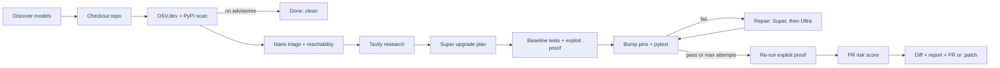

# PatchPilot

**An agentic DevSecOps tool for software supply chain security: it finds CVEs, upgrades dependencies, rewrites code until the tests pass, and proves the exploit is closed.**

Built on NVIDIA Nemotron (Nano / Super / Ultra) through any OpenAI-compatible endpoint (Nebius Token Factory, NVIDIA NIM, OpenRouter), with Tavily, OSV.dev and PyPI.

---

## The problem

Dependency bots open a version-bump PR and stop there. When the fix needs a **major** version, the bump breaks the build, the PR goes red, and the known vulnerability stays in production until someone finds time to migrate the code. The bump is easy. The fix is the hard part.

## How it works



1. **Scan**: every pin in `requirements.txt` is checked against OSV.dev; the latest version comes from PyPI.
2. **Triage**: Nemotron Nano judges each advisory against how your code actually uses the package.
3. **Research**: Tavily finds migration guides and breaking-change notes for each upgrade.
4. **Plan**: Nemotron Super picks target versions (with a version guardrail).
5. **Exploit proof**: a pytest demonstrating the vulnerability (from a curated, verified library for known CVEs, otherwise written by Nemotron) is run before the upgrade, then again after.
6. **Upgrade and repair**: pins are bumped in a fresh venv and pytest runs. On failure, Super writes the first fix; later attempts escalate to Ultra, up to `MAX_FIX_ATTEMPTS`.
7. **Ship**: risk score, unified diff, Markdown report with cited evidence, and a GitHub PR (when `GITHUB_TOKEN` is set and the repo is a GitHub URL) or a `.patch` file.

## Features

- **Live agent graph**: each pipeline step streams to the console over SSE.
- **Exploit proof**: a curated or Nemotron-written test shows the vulnerability before the upgrade and checks it is closed after.
- **Threat clock**: each advisory gets its live EPSS exploit probability (FIRST.org), CISA Known Exploited status and how many days it has been public, so you fix what attackers actually use first.
- **API drift radar**: before any test runs, PatchPilot walks your code's AST, then probes the *installed* old and new library versions in the sandbox to predict exactly which lines break (removed symbols, dropped keyword arguments), and hands that list to the repair model. Behaviour changes are left to the tests.
- **Least-change upgrade**: the smallest release that clears every advisory is computed from OSV fix ranges and shown next to the latest version.
- **Red-team variants**: after the fix, 5-8 variants of the attack (other algorithms, key types, encodings) run against the patched code; each is reported as closed by fix, already blocked, or still open.
- **Proof certificate (evidence ledger)**: every claim the PR makes, each checked independently, including a fresh OSV re-scan of the new pins, a trust score, and a SHA-256 over claims + diff.
- **Reranked research**: Tavily returns 8 results; Nemotron Nano scores each for relevance and only the top 4 reach the repair model.
- **PR risk score**: 0 to 100 from code churn, files touched, major-version jumps, repair attempts, test result and exploit proof.
- **Release trust check**: before upgrading, each old and target release is looked up on the free deps.dev v3 API: publish date, whether the target carries a *verified* PyPI publish attestation (and whether the old one did), its source repo, the repo's OpenSSF Scorecard (overall plus Code-Review, Maintained, Signed-Releases, Dangerous-Workflow) and any transitive dependencies the target adds. This feeds a "Supply-chain trust" risk factor (0 when deps.dev has no data) and a ledger claim. In our cases the latest releases (PyJWT 2.15.1, urllib3 2.8.0, Jinja2 3.1.6) all had verified attestations, while the old pins and the least-change targets from 2022-2024 (PyJWT 2.4.0, urllib3 1.26.19, Jinja2 3.1.3) had none; Scorecard is per repository, not per release (pyjwt 6.9, urllib3 8.6, jinja 5.9), and no upgrade added a new transitive dependency. slsaProvenances was empty for all of them.
- **Reachability map**: where each vulnerable package is used in your code.
- **Symbol-level reachability**: each advisory is labelled reachable (with file:line), imported-but-unused, not reachable, or unknown by matching its vulnerable symbols against an AST scan of your code (including re-exports and Jinja `|filter` uses in templates). Symbols come from OSV's PyPA `ecosystem_specific.imports` field when present, but in practice the OSV API returned that field for 0 of the advisories in our six benchmark cases, so most symbols are Nemotron Nano-inferred from the advisory text and labelled `llm-inferred`; if the LLM is unavailable those advisories stay `unknown`. The result feeds triage, an advisory-urgency rating next to the risk score, and a ledger claim (verified only when every symbol came from OSV).
- **Model debate**: each repair attempt's diagnosis (Super, then Ultra) side by side.
- **Org-wide heat map**: scans a GitHub user or org's public Python repos for vulnerable pins.
- **Replay**: recorded runs in `runs/` replay without spending API credits.
- **Voice briefing**: a spoken run summary using the browser's speech synthesis.
- **Cited evidence**: fixes quote the Tavily sources they relied on.

## Model routing

| Tier | Job |
|---|---|
| Nemotron **Nano** | Advisory triage against code usage (cheap, high volume) |
| Nemotron **Super** | Upgrade plan, exploit-proof test when no curated one exists (Ultra as fallback), first repair attempt |
| Nemotron **Ultra** | Escalated repair attempts when Super's fix still fails tests |

Models are auto-discovered from `/models` unless pinned with `MODEL_NANO` / `MODEL_SUPER` / `MODEL_ULTRA`. Tokens, latency and (if `PRICE_*` is set) cost are tracked per tier.

## Quickstart

**Windows**

```bat
run.bat
```

Creates `.venv`, installs dependencies, copies `.env.example` to `.env` on first run (opens it in Notepad for your keys), then serves http://localhost:8000.

**Manual (any OS, Python 3.10+)**

```bash
python -m venv .venv
source .venv/bin/activate          # Windows: .venv\Scripts\activate
pip install -r requirements.txt
cp .env.example .env               # add your keys
uvicorn patchpilot.server:app --port 8000
```

CLI / batch mode: `python -m patchpilot.cli`. Container: see `Dockerfile`.

- Pages: `/` landing, `/console` run the agent, `/runs` history and replay, `/org` org scan, `/how` architecture.
- API: `/api/health`, `/api/cases`, `/api/runs`, `/api/runs/{id}/events`, `/api/org/{owner}`, `/api/bench`.
- Demo cases in `cases/`: `authsvc` (PyJWT 1.x + requests) and `webhooks` (Werkzeug 2 to 3).

## Tests

Fast, offline unit tests for the agent itself (drift radar, OSV version math, JSON parsing, exploit library,
risk score and trust ledger). No network, no LLM calls:

```bash
pip install pytest
.venv/Scripts/python.exe -m pytest -q
```

`pytest.ini` limits collection to `tests/`; the bundled `cases/*/tests` suites need their own pinned venvs and
are run by PatchPilot's sandbox instead.

## Provider setup

The LLM client is OpenAI-compatible and reads `NEBIUS_API_KEY` and `NEBIUS_BASE_URL`, so any compatible provider works.

**Nebius Token Factory**
```ini
NEBIUS_API_KEY=your-nebius-key
NEBIUS_BASE_URL=https://api.tokenfactory.nebius.com/v1
```

**NVIDIA NIM**
```ini
NEBIUS_API_KEY=nvapi-...
NEBIUS_BASE_URL=https://integrate.api.nvidia.com/v1
```

**OpenRouter (free tier)**
```ini
NEBIUS_API_KEY=sk-or-...
NEBIUS_BASE_URL=https://openrouter.ai/api/v1
MODEL_NANO=nvidia/nemotron-3.5-lightning:free
MODEL_SUPER=nvidia/nemotron-3.5-super-vl:free
MODEL_ULTRA=nvidia/nemotron-3-ultra-550b-a55b:free
```

Optional: `TAVILY_API_KEY` (research; skipped if unset), `GITHUB_TOKEN` (real PRs, higher org-scan rate limit), `PRICE_*`, `MAX_FIX_ATTEMPTS`, and `ALLOW_REMOTE_REPOS=0` for public deployments (remote repos run arbitrary test code).

## Screenshots

| View | Image |
|---|---|
| Landing | `docs/screenshots/landing.png` |
| Live console | `docs/screenshots/console.png` |
| Exploit proof + risk score | `docs/screenshots/risk.png` |
| Model debate | `docs/screenshots/debate.png` |
| Org heat map | `docs/screenshots/org.png` |

## Comparison

| | Dependabot | Renovate | Snyk | PatchPilot |
|---|---|---|---|---|
| Detects vulnerable dependencies | Yes | Yes | Yes | Yes (OSV.dev) |
| Opens upgrade PRs | Yes | Yes | Yes | Yes |
| Rewrites your code to fix breaking changes | No | No | not verified | Yes (LLM repair loop) |
| Runs your tests before proposing the PR | No (relies on your CI) | No (relies on your CI) | not verified | Yes, in a sandbox venv |
| Generates an exploit-proof test | No | No | not verified | Yes |
| Open source | Yes | Yes | No | Yes (MIT) |
| Ecosystems | Many | Many | Many | Python only |

## Limitations

- Python only: needs a pinned `requirements.txt` (`pkg==x.y.z`) and a pytest suite.
- Tests run on the host in a venv, not a container; keep `ALLOW_REMOTE_REPOS=0` on public deployments.
- Free-tier models (e.g. OpenRouter `:free`) can be rate-limited, slow, or return malformed JSON, so runs may fail or need a retry.
- Green tests are only as strong as the repo's test suite.

## Roadmap

- Auto-rollback guard: revert an upgrade if post-merge checks regress.
- Slack bot: briefings and approvals in chat.
- npm ecosystem support.

## Credits

Vulnerability data from [OSV.dev](https://osv.dev). Package metadata from PyPI. Web research by [Tavily](https://tavily.com).

## License

MIT, see [LICENSE](LICENSE).
